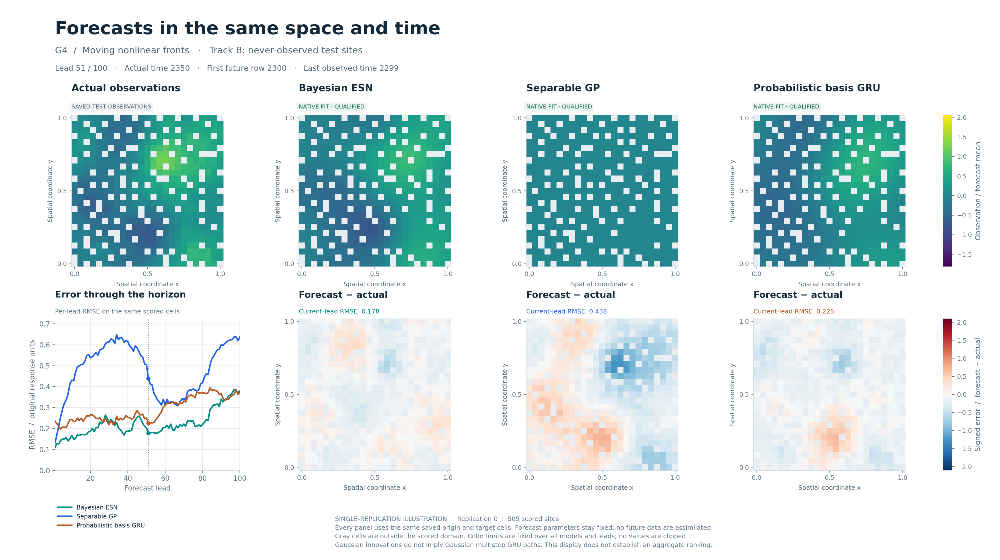
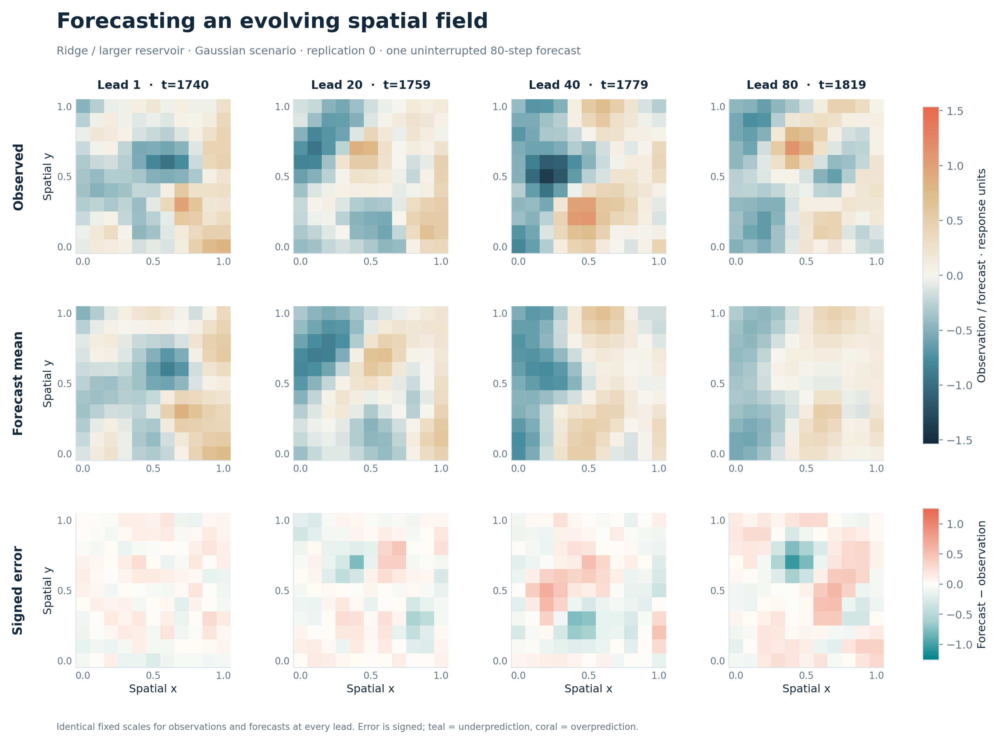

# bayes-stesn

Bayesian spatiotemporal echo state networks with explicit probabilistic models,
causal feature construction, posterior predictive trajectories, and reproducible
numerical checks. Python 3.11+, NumPy and SciPy; no GPU or deep-learning framework
is required.

The current implementation is a research release. The scalar/group/column
Gaussian routes use exact spectral calculations. Entrywise shrinkage and richer
latent/robust models use documented conditional samplers, with explicit numerical
and resource limits. Successful unit tests are distinct from passing an MCMC
diagnostic gate or demonstrating improved forecasting performance.

## v0.3 recovered study: current evidence

The [current findings](docs/results_v03.md) record completed recovery evidence
as of 2026-11-04. Both paired history conditions are complete: 163/165 outcomes
qualified at history 1000 and 164/165 at history 2000. The
[sealed rule](docs/evidence/v03/history_choice.json) retains 1000 for revised
development. Track A meets the declared native-CRPS improvement bound, but
Track B does not; incomplete shorter-history timing independently fails the
cost gate. This is an exploratory specification decision, not evidence of no
benefit from longer history.

The 25/50/100-sensor study has 33/33 qualified outcomes on one G4 field. Its
[representation audit](docs/evidence/v03/sensor_representation.json) is
descriptive and has no across-field MCSE. Bounded residual-AR, path-count,
conditional-prior and saved-decoder findings retain their qualification and
scope limits. Strict tuning is complete with 59/60 qualified outcomes and one
declared LGSSM fallback; the revised development pilot is 220/220 qualified.
All six preselected calibration cases and the two G5 arms plus corrected blind
G6 replay are complete. Calibration uses one field; stress comparisons use
five paired fields and do not establish a robustness ranking.

The unchanged confirmation authority admitted 60 datasets per scenario
(240 datasets; 2640 model/task jobs). The frozen plan retains
`mcse_target_not_met_at_cap`: its uncapped requirement is 102 per scenario.
The target normalized macro MCSE is 0.02; the frozen planning shortfall and
realized precision are separate quantities.

The [completed confirmation](results/v03/confirmation/frozen_run/summary.json)
contains all 2640 scheduled and attempted jobs: 2630 qualified outcomes and
10 declared fallbacks (seven ESN, three GRU). There are no pending jobs or
unresolved infrastructure failures. The separate
[native integrity check](results/v03/confirmation/operational/integrity_000/postcheck.json)
exited successfully with positive `--max-jobs 1`, zero submitted jobs and no
additional fits or forecasts; all prior immutable artifact bytes were preserved.

The [reviewed primary results](docs/results_v03.md#independent-confirmation-results)
show higher equal-weight macro normalized native CRPS for ESN than for either
separable GP or basis GRU on both tracks; all four ESN-minus-comparator
pointwise 95% bootstrap intervals are above zero. Track A remains heterogeneous:
ESN has lower conditional CRPS than GP in G3/G4 and than GRU in G4. Both Track A
macro MCSEs are below 0.02; both Track B MCSEs exceed it. The contrasts condition
on each cell's common-qualified native fits, while fallback point predictions
remain in the operational population. These pointwise comparisons do not
establish simultaneous rankings or generalization beyond the frozen experiment.

The [recovery and accounting record](docs/results_v03.md#confirmation-interruptions-and-filesystem-recovery)
distinguishes three confirmation incidents from the earlier pre-confirmation
interruptions. Recovery preserves the frozen design and independent dataset
count. Original lost post-checkpoint artifacts and measurements remain
unavailable; later recomputation has its own valid native receipts. Scientific
completion cannot make whole-campaign accounting complete.

The revised ordinary report and two fixed comparisons have completed
saved-artifact and sampled visual checks: 14 cases, 84 sampled-image reviews
and all 26 ordinary PDF pages. Browser review remains blocked and continuous
animation playback was not performed. Confirmation presentation has its own
fixed-case inventory and separate QA authority:
[the completed confirmation review](results/v03/rendering/confirmation_visual_qa.json)
records 12/12 mechanical passes, 72 actual first/middle/last MP4/GIF image
reviews and all 26 PDF pages, with embedded fonts and no blocking visual
findings. Browser viewport inspection remains blocked and continuous playback
was not performed; the receipt retains `publication_ready=false` for that
limited scope. The preselected replication-0 illustrations do not establish
aggregate model rankings.

This covered-source snapshot is dated 2026-11-04. Final synthesis, its QA,
source/installed-wheel validation and public delivery are resolved by their
generated receipts; this document does not preassert their success.

Use the [ordered reproduction guide](docs/reproduction_v03.md),
[saved-artifact synthesis guide](report/v03/README.md), and
[release procedure](docs/release_v03.md). The final generated R01–R20 closure
and separate publication readback receipt will record the actual release gates
without relabeling older test or public-release records as current evidence.

## Historical public releases and reports

[Version 0.2.1](https://github.com/AntonioAPDL/bayes-stesn/releases/tag/v0.2.1)
includes the checkpoint-continuation correction verified by the
[passing public CI run](https://github.com/AntonioAPDL/bayes-stesn/actions/runs/41580781455).
The original three-commit history and `v0.2.0` scientific snapshot are preserved.

| Download | Contents |
| --- | --- |
| [Benchmark report (PDF)](https://github.com/AntonioAPDL/bayes-stesn/releases/download/v0.2.1/bayes_stesn_v02_benchmark_report.pdf) | 27-page replicated development comparison |
| [Detailed forecast report (PDF)](https://github.com/AntonioAPDL/bayes-stesn/releases/download/v0.2.1/bayes_stesn_v02_detailed_forecast_report.pdf) | 10-page preselected nonlinear forecasting illustration |
| [Forecasts, truth, and errors (MP4)](https://github.com/AntonioAPDL/bayes-stesn/releases/download/v0.2.1/bayes_stesn_v02_forecast_truth_errors.mp4) | Synchronized ESN, GP, and GRU forecasts, signed errors, and RMSE evolution |
| [Simulated data evolution (MP4)](https://github.com/AntonioAPDL/bayes-stesn/releases/download/v0.2.1/bayes_stesn_v02_data_evolution.mp4) | The nonlinear field evolving through time |

The release also contains both complete-result archive parts, the original Git
bundle, and checksums. These numerical reports retain their original `v0.2.0`
source identity; the patch adds no new simulation results. See
[publication and validation evidence](docs/publication.md) for exact commits and
the distinction between software checks and scientific fit qualification.

## v0.3 development workflow

The current implementation adds schema-4 effective candidate tuning, mandatory
qualified finalist rechecks, explicit H-step neural stopping, bounded optimizer
allowances, common-endpoint learning curves, and paired precision planning.
The runner separates scientific and computation identities from mutable
execution settings, checks resource admission, and resumes verified fit phases
without granting a new sampling budget. Original schema-3 profiles retain their
identities and interpretation.

```bash
bstesn benchmark validate --config configs/benchmark/v03/pilot.yaml
bstesn benchmark plan --config configs/benchmark/v03/pilot.yaml \
  --workers 2 --max-memory-mb 5120
# After installing the full roster's CPU-neural dependencies:
bstesn benchmark run --config configs/benchmark/v03/smoke.yaml \
  --output results/v03/smoke --workers 2 --max-jobs 4
bstesn benchmark status results/v03/smoke
bstesn benchmark resume --output results/v03/smoke --workers 1 --max-jobs 4
```

Validation and planning do not fit models. The smoke profile checks execution;
it cannot establish scientific MCMC convergence. Development measurements,
software tests and completed confirmation are separate claims. See the
[current guide](docs/benchmark_guide.md),
[requirements and evidence status](docs/plans/v03_requirements.yaml),
[study design](docs/study_design_v03.md), and
[sampler/recovery derivation](docs/derivations/07_sampler_coordinates_recovery.md).
The historical release reports keep their original source identities;
the new workflow alone does not demonstrate better forecasts or a completed
confirmatory comparison.

## Install

```bash
python -m venv .venv
source .venv/bin/activate
python -m pip install -e '.[report,dev]'
python -m pytest -q tests
```

## API

```python
from bayes_stesn import (
    SpatioTemporalData, SplitPlan, ModelSpec, FeatureSpec, SpatialMeanSpec,
    PriorSpec, CovarianceSpec, SamplerConfig, prepare, fit, diagnose,
    forecast_context, simulate_predictive,
)

# y: [time, input_site], coordinates: [input_site, 2].
data = SpatioTemporalData(y, coordinates, response_units="measurement")
spec = ModelSpec(
    features=FeatureSpec(modes=10, units=(32, 32), lags=(1, 2, 4), squares=16),
    spatial_mean=SpatialMeanSpec(side=7, width=0.18),
    prior=PriorSpec.ridge(), covariance=CovarianceSpec(),
)
prepared = prepare(data, SplitPlan(conditioning=200, fitting_stop=len(y)), spec)
fitted = fit(prepared, SamplerConfig(chains=4, warmup=1000, draws=2000),
             checkpoint_path="checkpoints/model.npz")
checks = diagnose(fitted, functional_draws=512)
if not checks["passed"]:
    raise RuntimeError("Inspect diagnostics before interpreting this fit.")
prediction = simulate_predictive(
    fitted, forecast_context(fitted), horizon=40,
    target_coordinates=prediction_locations, paths=256, seed=17,
)
fitted.save("model.npz")
prediction.save("prediction.npz")
```

`prediction.observation` has dimensions `[path, lead, target_site]` in the original
response units. A parameter draw stays fixed throughout a trajectory; its own
simulated observations drive its future reservoir inputs. Readout means, latent
fields and conditional observation means are labeled separately.

## Historical version 0.2: model comparison framework

The package now includes shared G1-G6 simulators, eight core observed-site
comparators, native new-site comparators, and an optional probabilistic
coordinate-basis GRU control. Chronological/spatial validation, independent
final seeds, explicit failed-fit fallbacks, block calibration, matched learning
curves, process-parallel execution, and saved-result reports use one API.

```bash
# PyTorch is optional; install it for dcrnn and basis_gru.
python -m pip install -e '.[neural,report,dev]'
OPENBLAS_NUM_THREADS=1 OMP_NUM_THREADS=1 bstesn benchmark run \
  --profile smoke --output results/benchmark_smoke
bstesn benchmark report results/benchmark_smoke --output report/benchmark_smoke
```

The smoke profile verifies execution; its deliberately short MCMC/optimization
budgets do not qualify it as scientific evidence. Development and confirmation
profiles are separate, and confirmation requires a frozen design/power receipt.
The completed development pilot contains **300 model/task attempts across 20
independent datasets**: 251 qualified fits and 49 declared point fallbacks,
with no execution or scoring failures. Nineteen ESN fits failed MCMC diagnostics;
30 comparator fits reached their optimizer limits. The confirmation gate remains
blocked because ten primary comparisons lack three common qualified pilot
replications. These are development findings, not a completed confirmatory study.
See [the benchmark guide](docs/benchmark_guide.md),
[model equations](docs/benchmark_models.md), and
[the version 0.2 validation report](docs/benchmark_validation.md).



The image shows a preselected 100-step forecast at 505 never-observed sites.
All three native fits qualified in this separate one-dataset illustration;
the replicated pilot is a distinct comparison. See the
[saved numeric summary](docs/evidence/v02/detail_summary.json).

Memory-controlled predictive batches, bounded spatial-pair selection, atomic
failure cleanup, and the narrow end-to-end latent-Vecchia route address the
highest-impact engineering issues from the prior audit. Public data and
forecast constructors retain defensive-copy semantics.

## Documentation

- [Kuramoto–Sivashinsky application](docs/applications/ks_protocol.md): isolated clean-data unseen-site and all-observed experiments, with the [model registry](docs/applications/ks_model_registry.md), [preserved native-model audit](docs/applications/ks_native_audit.md), [reproduction and resume commands](docs/applications/ks_reproduction.md), and [verified preflight evidence](docs/applications/evidence/ks_preflight.json). This is a custom, literature-grounded experiment; its application results are separate from the frozen simulation study.
- [KS recovered results](docs/applications/ks_results_recovery.md): audited main-track tables, explicitly labeled robustness evidence, and the [incomplete original-artifact recovery status](docs/applications/ks_recovery_status.md).
- [v0.3 current findings](docs/results_v03.md): completed scientific evidence, exact populations and uncertainty, timing gaps, and pending gates.
- [v0.3 reproduction](docs/reproduction_v03.md), [report synthesis](report/v03/README.md), and [delivery](docs/release_v03.md): ordered saved-evidence commands and source-bound verification.
- [PRO implementation plan and execution prompt](docs/plans/PRO_IMPLEMENTATION_PLAN.md): staged improvements, resource budgets, acceptance gates, experiments, and publication requirements; implementation and evidence status are tracked separately in the [P0–P8 requirements map](docs/plans/v03_requirements.yaml).
- [Post-release audit](docs/audits/post_release_2026_11_03/README.md): reproducible findings that motivate the next implementation phase.
- `docs/api.md`: objects, workflows, serialization and supported combinations.
- `docs/models.md`: hierarchical models and implementation decisions.
- `docs/validation.md`: mathematical, statistical and integration verification.
- `docs/reproduction.md`: isolated installation, release checks and study commands.
- `docs/implementation_registry.yaml`: all 23 extension IDs and their limits.
- `docs/publication.md`: current public-repository and CI status.
- `docs/derivations/`: the complete mathematical blueprint and MCMC derivations.
- `configs/`: explicit reproducible experiment configurations.
- `benchmarks/`: resource pilots and controlled comparisons.
- `report/`: report-generation source; rendering never refits a model.

The primary controlled study compares scalar ridge with more data, larger
reservoirs and grouped Gaussian shrinkage. Two horseshoe development pilots
failed strict mixing checks and remain documented; those failures are not
presented as validated forecasting comparisons. Every implemented prior has
numerical and complete-workflow tests, which are a distinct claim.

## Earlier controlled study (version 0.1)

The locked study completed **48 four-chain fits**: four candidates, two spatial
innovation scenarios and six independent simulation replications. **47/48 fits
passed** both the hyperparameter and readout-functional gates (R-hat <= 1.01;
bulk/tail ESS >= 400). One grouped-Gaussian fit failed and remains visible.

| Change | Isotropic scenario: input CRPS difference | Anisotropic scenario: input CRPS difference |
|---|---:|---:|
| More likelihood history | -0.00266 [-0.00389, -0.00158] | -0.00199 [-0.00303, -0.00080] |
| Larger reservoirs, same long history | -0.01292 [-0.01869, -0.00399] | -0.01405 [-0.02074, -0.00626] |
| Group scales instead of scalar ridge | +0.00057 [-0.00001, +0.00102] | -0.00061 [-0.00139, -0.00002] |
| Historical validation-selection policy vs recent-history ridge | -0.01256 [-0.01969, -0.00451] | -0.01614 [-0.02188, -0.00876] |

Negative differences favor the change. Brackets are paired 95% bootstrap
intervals across independent replications, conditional on both compared fits
passing diagnostics. The grouped-prior isotropic comparison has five pairs;
the others have six. The validation-selected policy reduced mean input CRPS
by **13.7% and 17.8%** in these two scenarios, respectively.

Larger reservoirs delivered the clearest gain. More history alone slightly
worsened withheld-site accuracy, despite its input-site gains. Group-specific
shrinkage did not consistently improve on expressive ridge; both horseshoe
pilots failed convergence. These results favor expressive ridge as the first
working baseline for this DGP, while leaving more elaborate priors available
for tasks that justify them.



The study uses 49 observed inputs on an 11-by-11 grid, 740 versus 1,540 likelihood
times, a fixed conditioning history, and two 40-step final forecast origins.
The animation is a separately labeled, preselected uninterrupted 80-step
forecast. Six replications give limited precision; this is not a new full-size
comparison against the earlier V3 forecast. Full records and media are included
in the release download. [The archived compact summary](docs/evidence/v01/compact_summary.json) and
[protocol](docs/evidence/v01/protocol.json) retain the numerical evidence used above.

The version 0.1 release gate passed **149 source tests and the same 149 tests against the
installed wheel**, with no failures, errors, skips or warnings, in an isolated
Python 3.12 environment. Full-size fixed-parameter V3 parity covered 113,004
coefficients; the coefficient-mean relative discrepancy was 2.48e-12.
Conditional Gaussian SBC and sparse-covariance fidelity exercises are recorded
separately. See the release manifest and validation document for their scope.

## Scope

One response, a complete fixed panel of input sites, equally spaced times and
Euclidean coordinates are supported. Observations at additional locations may be
forecast jointly. Missing inputs, irregular-time dynamics, vector-valued responses,
unprojected geographic degrees, and unsupported combinations fail explicitly.

The iid Gaussian scalar-ridge Vecchia route now supports end-to-end operator
inference and ancestral prediction without dense site covariance matrices.
Sparse LU fill remains geometry-dependent. Other Vecchia combinations and
FEM/SPDE routes remain explicitly bounded reference implementations. No
million-site performance claim is made. The FEM implementation uses integer
operator orders with the stated Matérn smoothness.

## Reproducibility

The statistical core uses float64; optional PyTorch networks train on CPU in
float32. Artifacts are atomic, checksum-verified numeric NPZ files
with JSON metadata and `allow_pickle=False`. Named random streams do not depend on
process completion order. Seeds, software versions, numerical approximations and
forecast information policies are recorded. Same-environment reproducibility is
tested; bitwise equality across BLAS implementations is not promised.

## Attribution

The PCA reservoir core preserves the equations and random streams of the earlier
V3 project, with a numerical compatibility fixture. Established mathematical
constructions are cited in the derivation chapters. The ESN-specific reference-R²
and subspace constructions are adaptations, without a claim of new theory.

`ModelSpec.v3()` reproduces the reference architecture. Exact full-size parity
reuses the original standardized observations and frozen transformations. By
default, a newly prepared data set estimates response center/scale from all
supplied input sites during conditioning; the historical V3 experiment used
its preserved common-site normalization. These preprocessing policies should
not be silently equated when comparing raw-data fits.

Original project code and documentation: MIT license. Referenced papers and data
retain their respective licenses.

