# Bayesian ST-ESN: validation-only KS improvement study

**Status: COMPLETE.** Receipt snapshot: 2026-11-05T13:06:15.813651+00:00.

This is a custom, literature-grounded KS experiment. It is an exploratory follow-up motivated by the original application results. This campaign uses no test-partition labels. Its 14 confirmation trajectories were withheld from this campaign's configuration selection; they do not constitute a newly untouched test set for the wider research project.

The Gaussian likelihood, accepted scalar-ridge hierarchy, recursive path simulation, data adapter, and original scores remain the reference. A preserved-prior winner and, when eligible, a separate prior-scale sensitivity winner are selected within each spatial track. Prior-sensitivity results are never relabeled as the unchanged-prior model.

The retained hierarchy is $y_t=\Phi C z_t+e_t$, with $e_t\sim N(0,\sigma^2(I+qK_\ell))$ independently across time, and $\mathrm{vec}(C)\mid\sigma^2,\lambda\sim N(0,\sigma^2\lambda^{-1}I)$. Every readout coefficient, including the intercept, is shrunk. The scalar precision is inferred rather than equated with a deterministic ridge penalty. The preserved-prior stratum retains its track's reference hyperprior constants; a separate stratum changes declared prior scales. Exact constants and spatial-basis settings appear in the frozen configuration files. Residual innovations represent statistical discrepancy for the clean field, not added measurement noise.

## Scientific contract and aggregation

Training targets are [0,6000); all scored targets are within validation [6000,8000). History is 512 observations; each autonomous forecast has 100 steps, equal to 25 physical time units. Confirmation uses the frozen 14-trajectory roster and 20 first targets 6000,6100,…,7900, with 512 complete predictive paths per origin.

Track A uses 39 training sites and 13 interleaved validation sites. Track B uses all 64 observation sites. Track C uses 40 training sites and 12 contiguous withheld validation sites and has its own selection. No response-fitted artifact is transferred between these spatial protocols. Known coordinates are permitted. The delivered facade reads evaluation labels internally before separating its outputs; this is not a claim of future-free disk access.

For each complete trajectory, squared error is pooled over all its scheduled origins, target sites, and horizons, then square-rooted. The primary RMSE is the arithmetic mean of those trajectory RMSEs. It is not the mean of origin RMSEs and not the square root of the all-trajectory pooled MSE. The latter is exported separately as `complete_case_pooled_rmse`. MAE, CRPS, coverage and width are equally weighted by trajectory after averaging within trajectory. Point forecasts are means of complete predictive paths.

Uncertainty summaries resample entire trajectories, retaining all origins within each draw. Intervals are conditional on the frozen selection. Horizon bands are pointwise intervals. Paired differences use the explicit intersection of complete trajectories; missing or failed episodes are not imputed. Every finite catastrophic error remains in its score.

The selection loss gives equal weight to horizon bands 1–10,11–25,26–50,51–100. The ordinary 100-step confirmation aggregates below use uniform horizon weight. Selected settings are best among the configurations evaluated under the recorded staged budget.

A candidate's conditioning prefix calibrates its PCA/reservoir feature map and is excluded from its likelihood targets; the delivered scalar response transform separately uses permitted full-training observations. The usable training likelihood count is 6000 minus that conditioning length. This prefix, the 512-observation forecast synchronization history, the solver's physical spin-up and the sampler warm-up are distinct quantities. Candidate costs and fit diagnostics record the actual counts.

When included, point references keep their original frozen configurations and are refitted on each permitted training panel. Training mean, persistence, POD-VAR, ridge ESN and POD-NVAR provide fixed references rather than a newly retuned comparator study. Their periodic piecewise-linear decoder acts only on output: VAR/ESN recur in their observed-site state and POD methods in their declared latent state. The conventional ESN uses its own [1,r,r²] ridge readout and eigenvalue-radius convention, distinct from the Bayesian architecture's operator-norm control. Point methods receive no artificial Gaussian intervals.

## Confirmation results

### Track A: Interleaved unseen sites

| Candidate / role | Complete trajectories | Mean trajectory RMSE [95% CI] | CRPS [95% CI] | 90% coverage | 90% width |
|---|---:|---:|---:|---:|---:|
| bayes_03 (anchor) | 14/14 | 1.4025 [1.313, 1.5134] | 0.8346 [0.77564, 0.91187] | 0.91371 | 5.6168 |
| imp_a_joint_007_257c8c1b (main) | 14/14 | 1.2346 [1.1991, 1.2718] | 0.7391 [0.71503, 0.76532] | 0.94955 | 5.2442 |
| imp_a_prior_range_x2_0bcaed57 (sensitivity) | 14/14 | 1.4002 [1.3121, 1.5101] | 0.83333 [0.77515, 0.91054] | 0.91397 | 5.6166 |
| training_mean (cheap_anchor) | 14/14 | 1.2053 [1.1788, 1.2396] | — | — | — |
| persistence (cheap_anchor) | 14/14 | 1.2019 [1.1805, 1.2233] | — | — | — |
| linear_var (cheap_anchor) | 14/14 | 0.98914 [0.96575, 1.0128] | — | — | — |
| ridge_esn (cheap_anchor) | 14/14 | 1.3502 [1.303, 1.396] | — | — | — |
| pod_nvar (cheap_anchor) | 12/14 | 0.74464 [0.65353, 0.85059] | — | — | — |

| Candidate | Scheduled origins | Finite | Nonfinite/numerical rollout failures | Finite divergence | Failed-job blocked | Unqualified blocked | Pending | Full-schedule RMSE defined |
|---|---:|---:|---:|---:|---:|---:|---:|---:|
| bayes_03 | 280 | 280 | 0 | 0 | 0 | 0 | 0 | True |
| imp_a_joint_007_257c8c1b | 280 | 280 | 0 | 0 | 0 | 0 | 0 | True |
| imp_a_prior_range_x2_0bcaed57 | 280 | 280 | 0 | 0 | 0 | 0 | 0 | True |
| training_mean | 280 | 280 | 0 | 0 | 0 | 0 | 0 | True |
| persistence | 280 | 280 | 0 | 0 | 0 | 0 | 0 | True |
| linear_var | 280 | 280 | 0 | 0 | 0 | 0 | 0 | True |
| ridge_esn | 280 | 280 | 0 | 0 | 0 | 0 | 0 | True |
| pod_nvar | 280 | 278 | 2 | 2 | 0 | 0 | 0 | False |

Finite divergence means a point-forecast spatial RMSE exceeding 10 permitted-training standard deviations at any lead. A finite divergence remains scored; it is distinct from a failed numerical rollout. Blocked fits have no forecast outcome and are not counted as observed divergences. Reliability JSON retains every scheduled origin, the failure-or-divergence union, and all per-trajectory counts. A zero-event empirical bootstrap interval is not evidence of zero risk on new trajectories.

For pod_nvar, 38 additional finite origins belong to incomplete trajectories and remain in the reliability census, but not in the complete-trajectory accuracy table.

| Paired contrast (left − right) | Metric | Paired trajectories | Mean difference [95% CI] |
|---|---|---:|---:|
| imp_a_joint_007_257c8c1b − bayes_03 | rmse | 14/14 | -0.16792 [-0.26095, -0.085401] |
| imp_a_joint_007_257c8c1b − bayes_03 | crps | 14/14 | -0.095495 [-0.16246, -0.041867] |
| imp_a_prior_range_x2_0bcaed57 − bayes_03 | rmse | 14/14 | -0.0023463 [-0.0054757, 0.00033873] |
| imp_a_prior_range_x2_0bcaed57 − bayes_03 | crps | 14/14 | -0.0012682 [-0.0029273, 0.00010228] |
| imp_a_prior_range_x2_0bcaed57 − imp_a_joint_007_257c8c1b | rmse | 14/14 | 0.16557 [0.084571, 0.25741] |
| imp_a_prior_range_x2_0bcaed57 − imp_a_joint_007_257c8c1b | crps | 14/14 | 0.094227 [0.041476, 0.16125] |
| imp_a_joint_007_257c8c1b − training_mean | rmse | 14/14 | 0.029305 [-0.0035743, 0.065734] |
| imp_a_joint_007_257c8c1b − persistence | rmse | 14/14 | 0.032705 [-0.0052148, 0.071126] |
| imp_a_joint_007_257c8c1b − linear_var | rmse | 14/14 | 0.24548 [0.21544, 0.27607] |
| imp_a_joint_007_257c8c1b − ridge_esn | rmse | 14/14 | -0.11562 [-0.17132, -0.064459] |
| imp_a_joint_007_257c8c1b − pod_nvar | rmse | 12/14 | 0.48942 [0.38932, 0.5812] |

Negative RMSE/CRPS differences favor the left candidate. Incomplete intersections support only conditional comparisons.

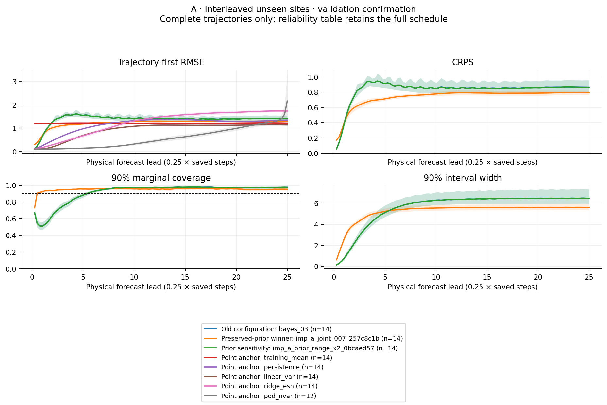

[Publication PDF: horizon_A.pdf](horizon_A.pdf)

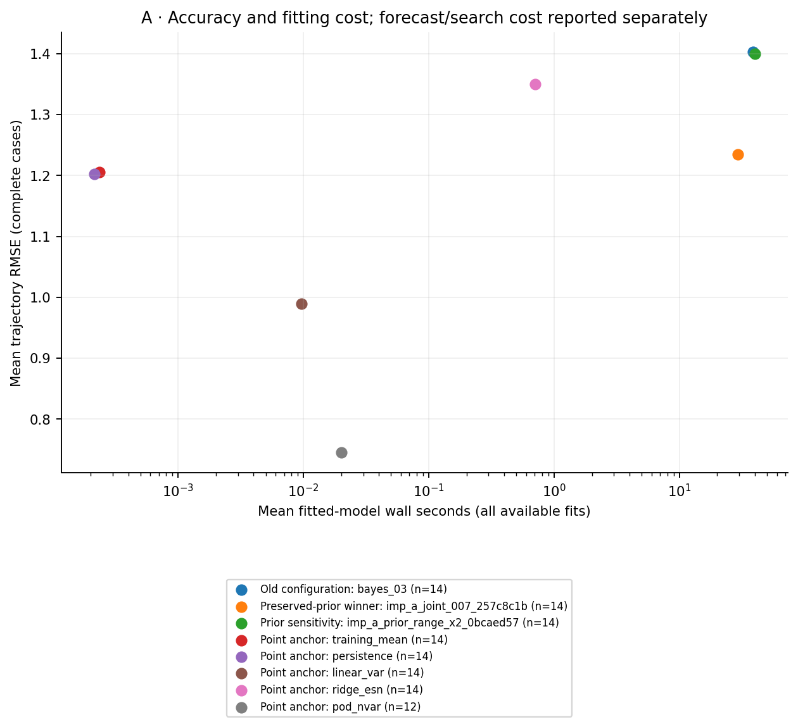

[Publication PDF: compute_A.pdf](compute_A.pdf)

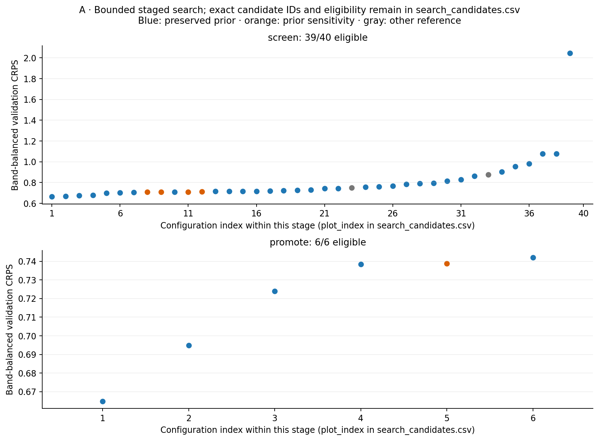

[Publication PDF: search_A.pdf](search_A.pdf)

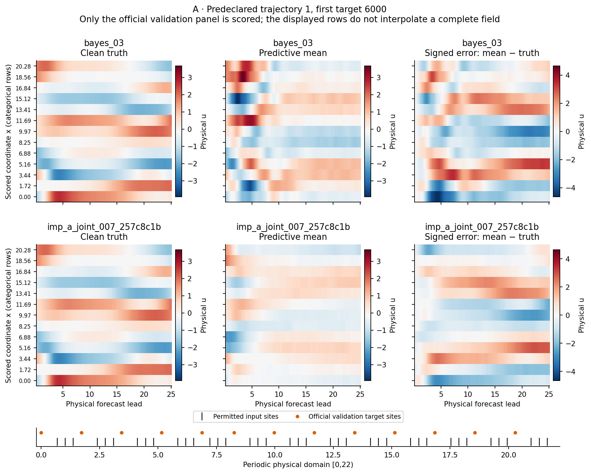

[Publication PDF: example_A_t01_a6000.pdf](example_A_t01_a6000.pdf)

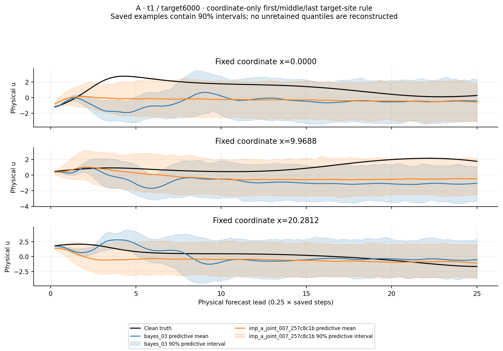

[Publication PDF: intervals_A_t01_a6000.pdf](intervals_A_t01_a6000.pdf)

### Track B: All observed sites

| Candidate / role | Complete trajectories | Mean trajectory RMSE [95% CI] | CRPS [95% CI] | 90% coverage | 90% width |
|---|---:|---:|---:|---:|---:|
| bayes_01 (anchor) | 14/14 | 1.1938 [1.1735, 1.215] | 0.72702 [0.70209, 0.75516] | 0.97909 | 6.0668 |
| imp_b_lag_1_886dd32b (main) | 14/14 | 1.1568 [1.1201, 1.1942] | 0.66126 [0.63671, 0.68741] | 0.92677 | 4.2108 |
| imp_b_prior_precision_x01_e2eaa754 (sensitivity) | 14/14 | 1.1929 [1.1734, 1.2139] | 0.72651 [0.70188, 0.75444] | 0.97912 | 6.0674 |
| training_mean (cheap_anchor) | 14/14 | 1.2076 [1.1801, 1.2437] | — | — | — |
| persistence (cheap_anchor) | 14/14 | 1.2509 [1.2283, 1.2734] | — | — | — |
| linear_var (cheap_anchor) | 14/14 | 0.99506 [0.96965, 1.0186] | — | — | — |
| ridge_esn (cheap_anchor) | 14/14 | 1.2843 [1.2562, 1.3125] | — | — | — |
| pod_nvar (cheap_anchor) | 11/14 | 0.28558 [0.24371, 0.32722] | — | — | — |

| Candidate | Scheduled origins | Finite | Nonfinite/numerical rollout failures | Finite divergence | Failed-job blocked | Unqualified blocked | Pending | Full-schedule RMSE defined |
|---|---:|---:|---:|---:|---:|---:|---:|---:|
| bayes_01 | 280 | 280 | 0 | 0 | 0 | 0 | 0 | True |
| imp_b_lag_1_886dd32b | 280 | 280 | 0 | 0 | 0 | 0 | 0 | True |
| imp_b_prior_precision_x01_e2eaa754 | 280 | 280 | 0 | 0 | 0 | 0 | 0 | True |
| training_mean | 280 | 280 | 0 | 0 | 0 | 0 | 0 | True |
| persistence | 280 | 280 | 0 | 0 | 0 | 0 | 0 | True |
| linear_var | 280 | 280 | 0 | 0 | 0 | 0 | 0 | True |
| ridge_esn | 280 | 280 | 0 | 0 | 0 | 0 | 0 | True |
| pod_nvar | 280 | 277 | 3 | 0 | 0 | 0 | 0 | False |

Finite divergence means a point-forecast spatial RMSE exceeding 10 permitted-training standard deviations at any lead. A finite divergence remains scored; it is distinct from a failed numerical rollout. Blocked fits have no forecast outcome and are not counted as observed divergences. Reliability JSON retains every scheduled origin, the failure-or-divergence union, and all per-trajectory counts. A zero-event empirical bootstrap interval is not evidence of zero risk on new trajectories.

For pod_nvar, 57 additional finite origins belong to incomplete trajectories and remain in the reliability census, but not in the complete-trajectory accuracy table.

| Paired contrast (left − right) | Metric | Paired trajectories | Mean difference [95% CI] |
|---|---|---:|---:|
| imp_b_lag_1_886dd32b − bayes_01 | rmse | 14/14 | -0.036965 [-0.087509, 0.010954] |
| imp_b_lag_1_886dd32b − bayes_01 | crps | 14/14 | -0.065758 [-0.10985, -0.026468] |
| imp_b_prior_precision_x01_e2eaa754 − bayes_01 | rmse | 14/14 | -0.0008505 [-0.0022021, 0.00042908] |
| imp_b_prior_precision_x01_e2eaa754 − bayes_01 | crps | 14/14 | -0.00050959 [-0.001198, 0.00013235] |
| imp_b_prior_precision_x01_e2eaa754 − imp_b_lag_1_886dd32b | rmse | 14/14 | 0.036114 [-0.010989, 0.086297] |
| imp_b_prior_precision_x01_e2eaa754 − imp_b_lag_1_886dd32b | crps | 14/14 | 0.065249 [0.026516, 0.10878] |
| imp_b_lag_1_886dd32b − training_mean | rmse | 14/14 | -0.050804 [-0.099856, -0.0074405] |
| imp_b_lag_1_886dd32b − persistence | rmse | 14/14 | -0.094064 [-0.13439, -0.049215] |
| imp_b_lag_1_886dd32b − linear_var | rmse | 14/14 | 0.16177 [0.11936, 0.20594] |
| imp_b_lag_1_886dd32b − ridge_esn | rmse | 14/14 | -0.12747 [-0.17839, -0.076629] |
| imp_b_lag_1_886dd32b − pod_nvar | rmse | 11/14 | 0.86579 [0.80592, 0.92573] |

Negative RMSE/CRPS differences favor the left candidate. Incomplete intersections support only conditional comparisons.

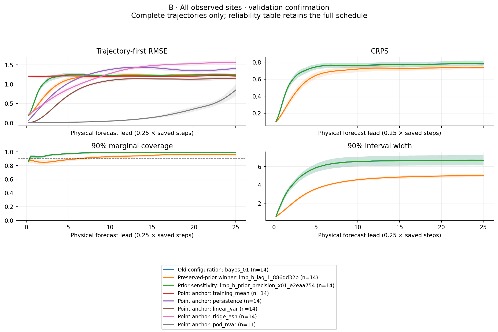

[Publication PDF: horizon_B.pdf](horizon_B.pdf)

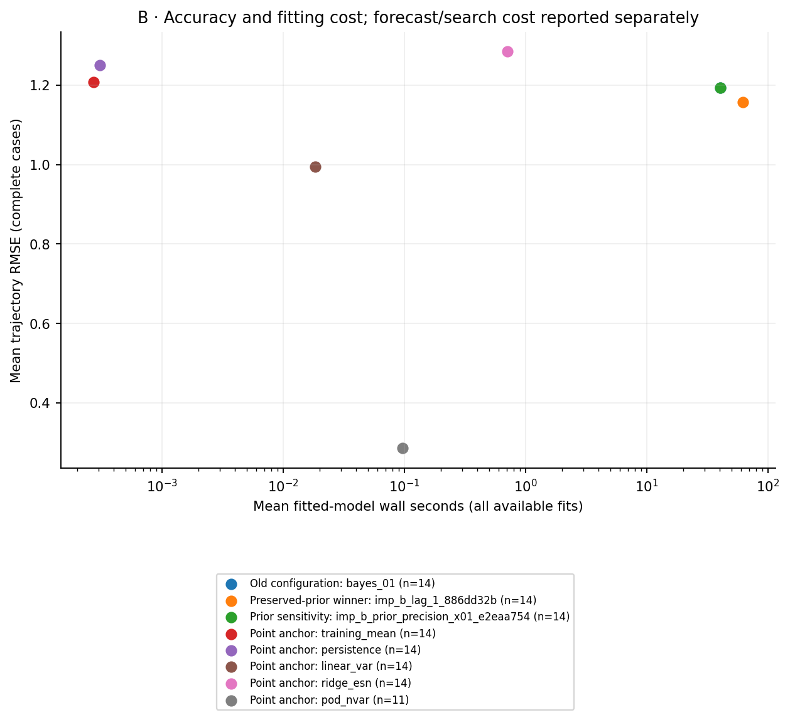

[Publication PDF: compute_B.pdf](compute_B.pdf)

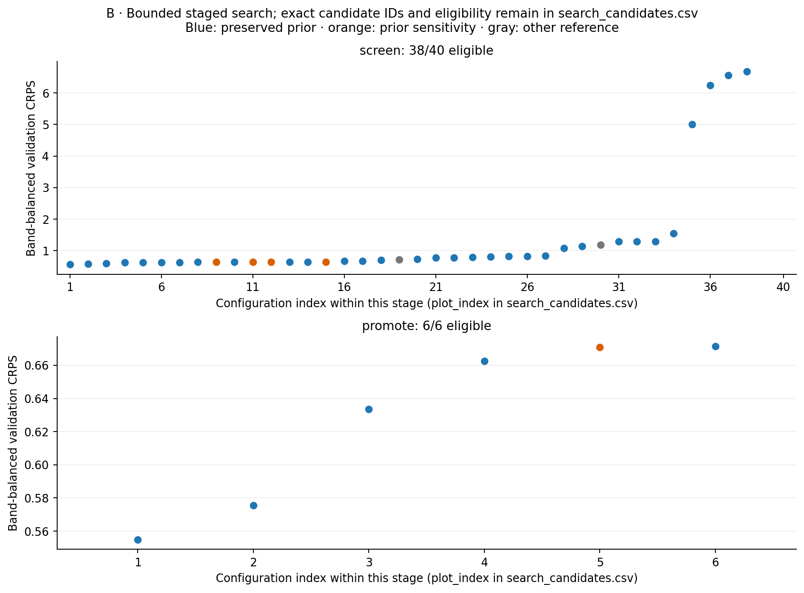

[Publication PDF: search_B.pdf](search_B.pdf)

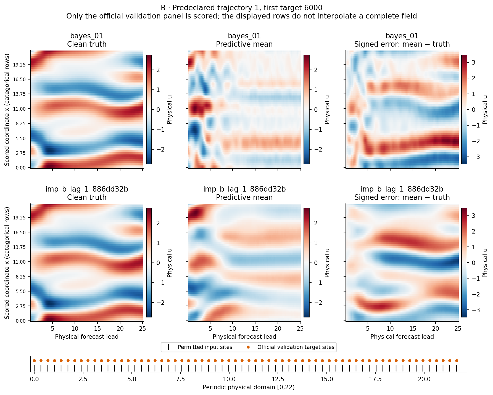

[Publication PDF: example_B_t01_a6000.pdf](example_B_t01_a6000.pdf)

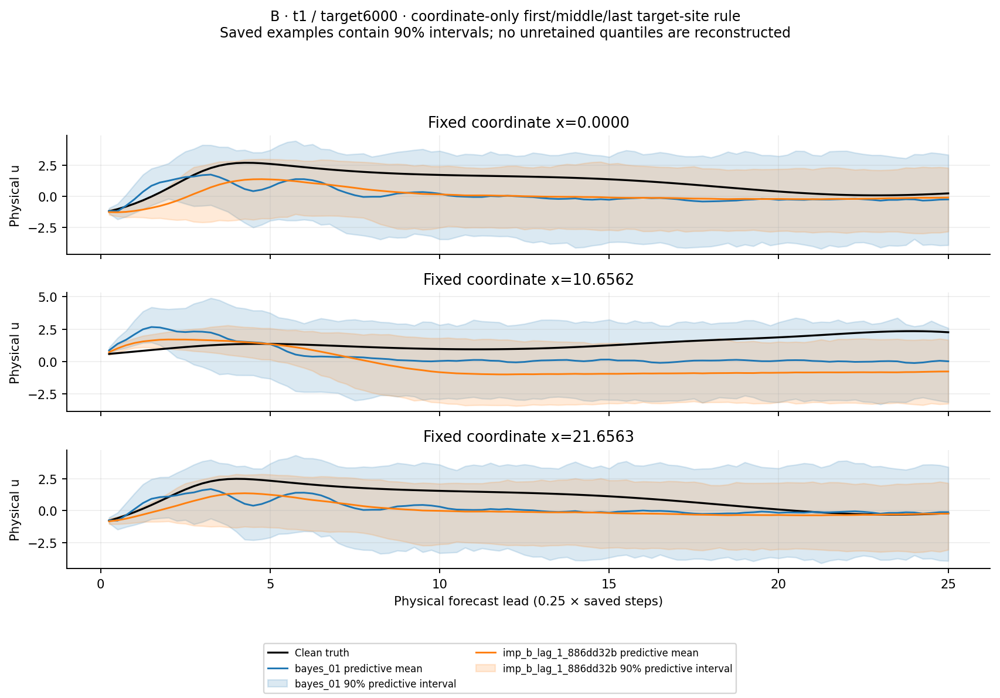

[Publication PDF: intervals_B_t01_a6000.pdf](intervals_B_t01_a6000.pdf)

### Track C: Contiguous unseen sites

| Candidate / role | Complete trajectories | Mean trajectory RMSE [95% CI] | CRPS [95% CI] | 90% coverage | 90% width |
|---|---:|---:|---:|---:|---:|
| bayes_03 (anchor) | 14/14 | 2442.4 [1444.8, 4169] | 1136.4 [756.34, 1804.3] | 0.93063 | 9430 |
| imp_c_joint_003_c09e9d65 (main) | 14/14 | 2.197 [2.0138, 2.373] | 2.5135 [2.4229, 2.6007] | 0.99352 | 33.358 |
| imp_c_prior_range_x05_1eff16da (sensitivity) | 14/14 | 1711.5 [1428.8, 1996.6] | 848.1 [746.29, 949.63] | 0.92997 | 6981.7 |
| training_mean (cheap_anchor) | 14/14 | 1.2228 [1.1785, 1.2747] | — | — | — |
| persistence (cheap_anchor) | 14/14 | 1.5173 [1.4398, 1.5938] | — | — | — |
| linear_var (cheap_anchor) | 14/14 | 1.3221 [1.2788, 1.3679] | — | — | — |
| ridge_esn (cheap_anchor) | 14/14 | 2.1251 [1.9614, 2.2898] | — | — | — |
| pod_nvar (cheap_anchor) | 0/14 | — | — | — | — |

| Candidate | Scheduled origins | Finite | Nonfinite/numerical rollout failures | Finite divergence | Failed-job blocked | Unqualified blocked | Pending | Full-schedule RMSE defined |
|---|---:|---:|---:|---:|---:|---:|---:|---:|
| bayes_03 | 280 | 280 | 0 | 280 | 0 | 0 | 0 | True |
| imp_c_joint_003_c09e9d65 | 280 | 280 | 0 | 5 | 0 | 0 | 0 | True |
| imp_c_prior_range_x05_1eff16da | 280 | 280 | 0 | 280 | 0 | 0 | 0 | True |
| training_mean | 280 | 280 | 0 | 0 | 0 | 0 | 0 | True |
| persistence | 280 | 280 | 0 | 0 | 0 | 0 | 0 | True |
| linear_var | 280 | 280 | 0 | 0 | 0 | 0 | 0 | True |
| ridge_esn | 280 | 280 | 0 | 0 | 0 | 0 | 0 | True |
| pod_nvar | 280 | 99 | 181 | 17 | 0 | 0 | 0 | False |

Finite divergence means a point-forecast spatial RMSE exceeding 10 permitted-training standard deviations at any lead. A finite divergence remains scored; it is distinct from a failed numerical rollout. Blocked fits have no forecast outcome and are not counted as observed divergences. Reliability JSON retains every scheduled origin, the failure-or-divergence union, and all per-trajectory counts. A zero-event empirical bootstrap interval is not evidence of zero risk on new trajectories.

For pod_nvar, 99 additional finite origins belong to incomplete trajectories and remain in the reliability census, but not in the complete-trajectory accuracy table.

| Paired contrast (left − right) | Metric | Paired trajectories | Mean difference [95% CI] |
|---|---|---:|---:|
| imp_c_joint_003_c09e9d65 − bayes_03 | rmse | 14/14 | -2440.2 [-4166.7, -1442.6] |
| imp_c_joint_003_c09e9d65 − bayes_03 | crps | 14/14 | -1133.9 [-1801.8, -753.85] |
| imp_c_prior_range_x05_1eff16da − bayes_03 | rmse | 14/14 | -730.86 [-2195.8, 4.1038] |
| imp_c_prior_range_x05_1eff16da − bayes_03 | crps | 14/14 | -288.34 [-865.89, 1.397] |
| imp_c_prior_range_x05_1eff16da − imp_c_joint_003_c09e9d65 | rmse | 14/14 | 1709.3 [1426.7, 1994.5] |
| imp_c_prior_range_x05_1eff16da − imp_c_joint_003_c09e9d65 | crps | 14/14 | 845.59 [743.7, 947.11] |
| imp_c_joint_003_c09e9d65 − training_mean | rmse | 14/14 | 0.97427 [0.81686, 1.1329] |
| imp_c_joint_003_c09e9d65 − persistence | rmse | 14/14 | 0.67971 [0.48246, 0.86607] |
| imp_c_joint_003_c09e9d65 − linear_var | rmse | 14/14 | 0.87496 [0.70924, 1.0346] |
| imp_c_joint_003_c09e9d65 − ridge_esn | rmse | 14/14 | 0.071922 [-0.10647, 0.23938] |
| imp_c_joint_003_c09e9d65 − pod_nvar | rmse | 0/14 | — |

Negative RMSE/CRPS differences favor the left candidate. Incomplete intersections support only conditional comparisons.

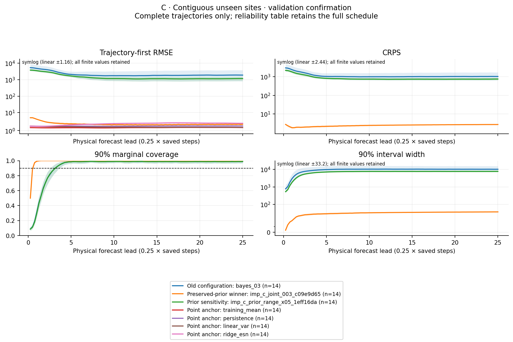

[Publication PDF: horizon_C.pdf](horizon_C.pdf)

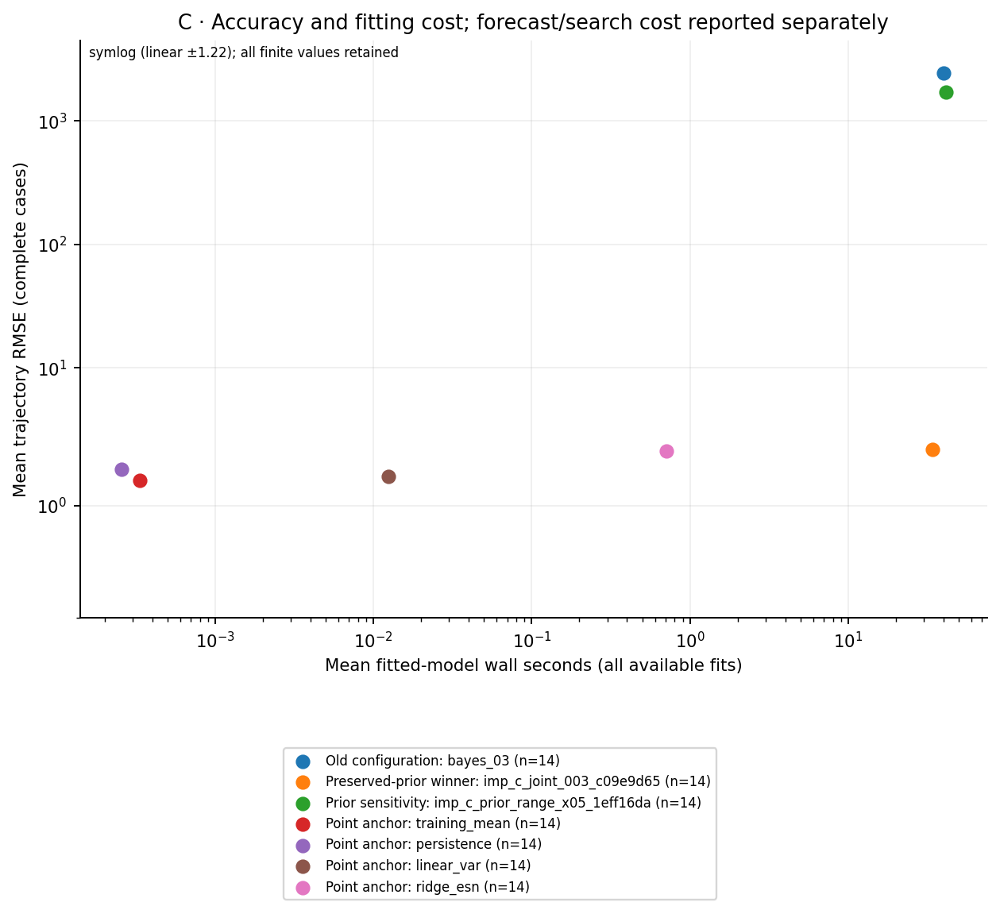

[Publication PDF: compute_C.pdf](compute_C.pdf)

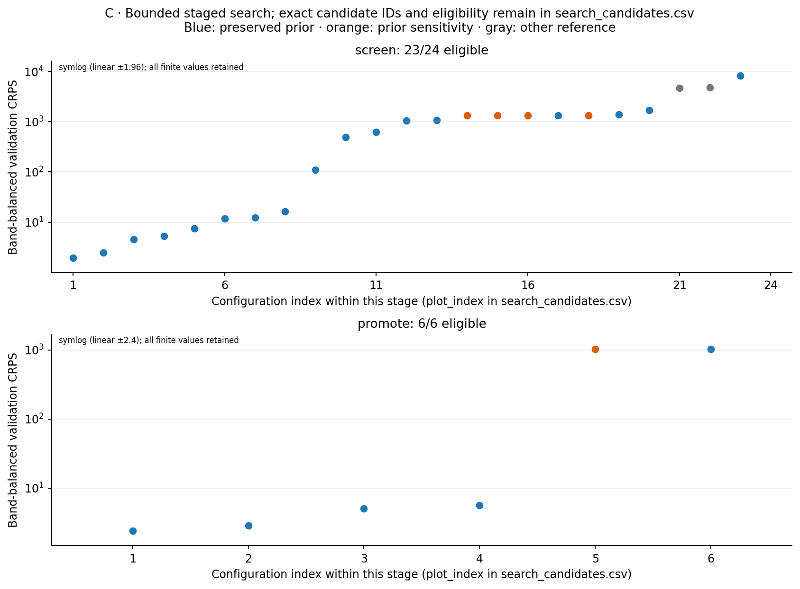

[Publication PDF: search_C.pdf](search_C.pdf)

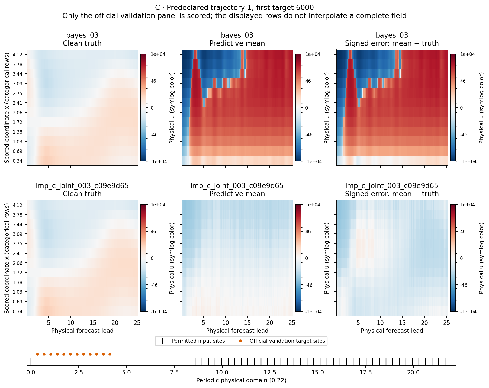

[Publication PDF: example_C_t01_a6000.pdf](example_C_t01_a6000.pdf)

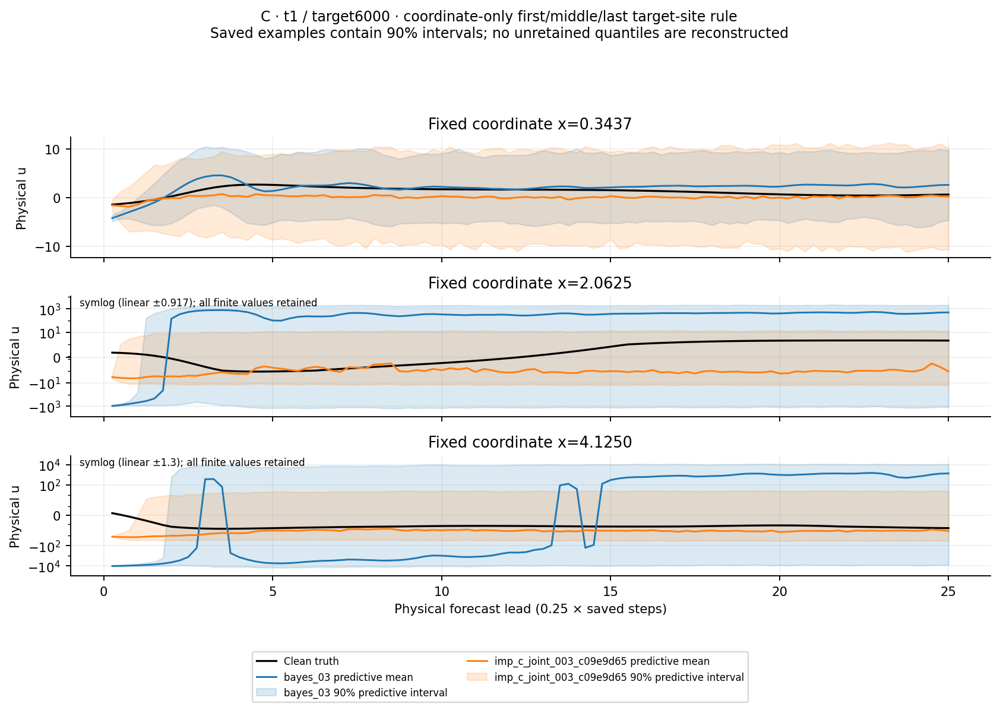

[Publication PDF: intervals_C_t01_a6000.pdf](intervals_C_t01_a6000.pdf)

## Screening, selected settings, and inference

`search_candidates.csv` retains every completed stage row, including ineligible candidates and their failure/qualification counts. `candidate_registry.json` contains the exact original proposal roster and `selected_configurations.json` the frozen choices. The proposal budget is 40 candidates for A,40 for B,24 for C, including reference and prior-sensitivity strata. The staged plan promotes four preserved-prior candidates plus one prior-sensitivity candidate and the old selected configuration. Predictive Monte Carlo repetitions assess simulation variability on fixed validation cases; this is different from sampler convergence or trajectory-sampling uncertainty. Near-tie selection follows the frozen precision rule rather than choosing the smallest noisy point estimate.

`realized_dynamics.json` records each configured recurrent operator norm and the actual operator norm and eigenvalue spectral radius measured on training-only feature maps. Those two quantities are not interchangeable. It also records reservoir sizes, leak patterns, input scales, connectivity, PCA modes, lags, square features, conditioning length, and readout size. History synchronization is an empirical training-endpoint check, not a universal stability guarantee.

`fit_diagnostics.json` records qualification, actual continuations, and extrema of the final monitored coefficient, hyperparameter and predictive-functional diagnostics. The established four-chain R-hat/ESS gate is unchanged. MCMC qualification does not imply accurate forecasts. Native predictive paths hold a parameter draw fixed along the entire path and propagate their own input-site predictions.

| Track / stratum | Candidates | Configured operator norm range | Realized eigenvalue-radius range | Reservoir units | Input-scale range | Leak range |
|---|---:|---:|---:|---:|---:|---:|
| A / legacy_prior_reference | 2 | 0.9–0.9 | 0.43281–0.43281 | 64–64 | 0.5–0.5 | 0.2–0.9 |
| A / main_fixed_prior | 34 | 0.3–0.98 | 0.050798–0.46124 | 32–512 | 0.05–2 | 0.05–1 |
| A / prior_scale_sensitivity | 4 | 0.9–0.9 | 0.42359–0.42359 | 128–128 | 0.5–0.5 | 0.2–0.9 |
| B / legacy_prior_reference | 2 | 0.9–0.9 | 0.38962–0.42359 | 32–128 | 0.5–0.5 | 0.2–0.9 |
| B / main_fixed_prior | 34 | 0.3–0.98 | 0.1412–0.47455 | 32–512 | 0.05–2 | 0.05–1 |
| B / prior_scale_sensitivity | 4 | 0.9–0.9 | 0.43281–0.43281 | 64–64 | 0.5–0.5 | 0.2–0.9 |
| C / legacy_prior_reference | 2 | 0.9–0.9 | 0.43281–0.43281 | 64–64 | 0.5–0.5 | 0.2–0.9 |
| C / main_fixed_prior | 18 | 0.3–0.9 | 0.050798–0.4401 | 32–128 | 0.2–2 | 0.05–0.9 |
| C / prior_scale_sensitivity | 4 | 0.9–0.9 | 0.42359–0.42359 | 128–128 | 0.5–0.5 | 0.2–0.9 |

| Track / role | Selected candidate | Reservoir units | Operator norm | Leak pattern(s) | Input scale(s) | PCA modes / squares | Conditioning rows |
|---|---|---:|---:|---|---|---:|---:|
| A / anchor | bayes_03 | [128] | 0.9 | [[0.2, 0.5, 0.9]] | [0.5] | 16 / 64 | 1024 |
| A / main | imp_a_joint_007_257c8c1b | [32] | 0.98 | [[1.0]] | [2.0] | 8 / 32 | 1024 |
| A / sensitivity | imp_a_prior_range_x2_0bcaed57 | [128] | 0.9 | [[0.2, 0.5, 0.9]] | [0.5] | 16 / 64 | 1024 |
| B / anchor | bayes_01 | [64] | 0.9 | [[0.2, 0.5, 0.9]] | [0.5] | 8 / 32 | 512 |
| B / main | imp_b_lag_1_886dd32b | [64] | 0.9 | [[0.2, 0.5, 0.9]] | [0.5] | 8 / 32 | 512 |
| B / sensitivity | imp_b_prior_precision_x01_e2eaa754 | [64] | 0.9 | [[0.2, 0.5, 0.9]] | [0.5] | 8 / 32 | 512 |
| C / anchor | bayes_03 | [128] | 0.9 | [[0.2, 0.5, 0.9]] | [0.5] | 16 / 64 | 1024 |
| C / main | imp_c_joint_003_c09e9d65 | [128] | 0.9 | [[0.05]] | [0.5] | 16 / 64 | 2048 |
| C / sensitivity | imp_c_prior_range_x05_1eff16da | [128] | 0.9 | [[0.2, 0.5, 0.9]] | [0.5] | 16 / 64 | 1024 |

### Which individual controls changed screen performance?

These candidate-minus-original-anchor changes use the same two trajectories and four validation windows per trajectory. They are exploratory selection diagnostics (n=2), not confirmation estimates or causal effects. Joint proposals and prior sensitivities are retained separately in `controlled_screen_contrasts.csv` and are not mixed into this table.

| Track | Candidate alias | Changed effective fields | Screen CRPS | ΔCRPS vs old | Screen MSE | ΔMSE vs old | Paired n |
|---|---|---|---:|---:|---:|---:|---:|
| A | input_scale_200 | features.input_scales | 0.66686 | -0.043017 | 1.3255 | -0.22084 | 2 |
| A | conditioning_alternative | conditioning | 0.67417 | -0.035714 | 1.3056 | -0.24072 | 2 |
| A | spatial_width_015 | spatial_mean.width | 0.7061 | -0.0037821 | 1.457 | -0.089331 | 2 |
| A | pca_alternative | features.modes | 0.71504 | 0.0051638 | 1.7213 | 0.17493 | 2 |
| A | operator_norm_030 | features.recurrent_norm | 0.71572 | 0.0058418 | 1.5663 | 0.019901 | 2 |
| A | connectivity_002 | features.connectivity | 0.71673 | 0.006852 | 1.5512 | 0.0048693 | 2 |
| A | operator_norm_098 | features.recurrent_norm | 0.72078 | 0.010902 | 1.5972 | 0.050826 | 2 |
| A | lags_1_2_4 | features.lags | 0.72334 | 0.01346 | 1.6928 | 0.14645 | 2 |
| A | connectivity_020 | features.connectivity | 0.7258 | 0.015923 | 1.6107 | 0.064338 | 2 |
| A | scalar_leak_100 | features.leak_patterns | 0.73077 | 0.020893 | 1.662 | 0.1156 | 2 |
| A | no_square_terms | features.squares | 0.74382 | 0.033943 | 1.6479 | 0.10148 | 2 |
| A | spatial_width_060 | spatial_mean.width | 0.74424 | 0.034363 | 1.6748 | 0.12845 | 2 |
| A | conditioning_2048 | conditioning | 0.75865 | 0.048766 | 1.6615 | 0.11509 | 2 |
| A | spatial_width_100 | spatial_mean.width | 0.76157 | 0.051693 | 1.7306 | 0.18423 | 2 |
| A | lag_1 | features.lags | 0.78403 | 0.074149 | 1.956 | 0.40964 | 2 |
| A | units_256 | features.units | 0.79064 | 0.080758 | 1.9335 | 0.38717 | 2 |
| A | scalar_leak_010 | features.leak_patterns | 0.79364 | 0.083765 | 1.8025 | 0.2561 | 2 |
| A | pca_32 | features.modes | 0.81393 | 0.10405 | 2.0624 | 0.51603 | 2 |
| A | spatial_rank_12 | spatial_mean.centers | 0.82787 | 0.11799 | 1.4005 | -0.14592 | 2 |
| A | spatial_rank_8 | spatial_mean.centers | 0.86167 | 0.15179 | 1.4684 | -0.077969 | 2 |
| A | scalar_leak_005 | features.leak_patterns | 0.95373 | 0.24385 | 2.416 | 0.86965 | 2 |
| A | input_scale_005 | features.input_scales | 2.0465 | 1.3366 | 6.1561 | 4.6098 | 2 |
| B | lag_1 | features.lags | 0.56045 | -0.084089 | 1.0802 | -0.29792 | 2 |
| B | units_256 | features.units | 0.57497 | -0.069564 | 1.2214 | -0.15671 | 2 |
| B | input_scale_200 | features.input_scales | 0.58782 | -0.056718 | 1.0572 | -0.32097 | 2 |
| B | scalar_leak_100 | features.leak_patterns | 0.6229 | -0.021642 | 1.2228 | -0.15537 | 2 |
| B | operator_norm_030 | features.recurrent_norm | 0.62418 | -0.020355 | 1.2963 | -0.081873 | 2 |
| B | connectivity_002 | features.connectivity | 0.62418 | -0.020354 | 1.2827 | -0.095378 | 2 |
| B | operator_norm_098 | features.recurrent_norm | 0.6295 | -0.015035 | 1.3184 | -0.059767 | 2 |
| B | connectivity_020 | features.connectivity | 0.63784 | -0.0066993 | 1.3586 | -0.019513 | 2 |
| B | no_square_terms | features.squares | 0.64433 | -0.00021019 | 1.2133 | -0.16479 | 2 |
| B | lags_1_2_4 | features.lags | 0.67387 | 0.029334 | 1.2886 | -0.0895 | 2 |
| B | spatial_width_060 | spatial_mean.width | 0.67703 | 0.032492 | 1.4717 | 0.093592 | 2 |
| B | spatial_width_100 | spatial_mean.width | 0.70582 | 0.061283 | 1.5117 | 0.1336 | 2 |
| B | scalar_leak_005 | features.leak_patterns | 0.77182 | 0.12728 | 1.7792 | 0.4011 | 2 |
| B | conditioning_2048 | conditioning | 0.77328 | 0.12874 | 1.3103 | -0.067811 | 2 |
| B | pca_32 | features.modes | 0.79427 | 0.14973 | 1.5337 | 0.15555 | 2 |
| B | scalar_leak_010 | features.leak_patterns | 0.82309 | 0.17856 | 1.6631 | 0.28495 | 2 |
| B | conditioning_alternative | conditioning | 0.83342 | 0.18888 | 1.589 | 0.21088 | 2 |
| B | spatial_rank_12 | spatial_mean.centers | 1.0717 | 0.42716 | 1.6871 | 0.30896 | 2 |
| B | spatial_rank_8 | spatial_mean.centers | 1.1411 | 0.49656 | 1.5327 | 0.15458 | 2 |
| B | input_scale_005 | features.input_scales | 6.2437 | 5.5991 | 106.42 | 105.04 | 2 |
| B | spatial_width_015 | spatial_mean.width | — | — | — | — | 0 |
| C | spatial_width_100 | spatial_mean.width | 5.2929 | -1341.9 | 119.7 | -9.4058e+06 | 2 |
| C | spatial_rank_8 | spatial_mean.centers | 7.4829 | -1339.7 | 248.57 | -9.4057e+06 | 2 |
| C | spatial_rank_12 | spatial_mean.centers | 12.321 | -1334.9 | 965.57 | -9.405e+06 | 2 |
| C | spatial_width_060 | spatial_mean.width | 16.336 | -1330.8 | 1070 | -9.4049e+06 | 2 |
| C | conditioning_2048 | conditioning | 1057 | -290.14 | 5.6683e+06 | -3.7377e+06 | 2 |
| C | input_scale_020 | features.input_scales | 1080.4 | -266.76 | 5.3528e+06 | -4.0531e+06 | 2 |
| C | operator_norm_060 | features.recurrent_norm | 1383.5 | 36.32 | 9.7978e+06 | 3.9186e+05 | 2 |
| C | pca_8 | features.modes | 1698.4 | 351.19 | 1.2294e+07 | 2.8877e+06 | 2 |
| C | spatial_rank_20 | spatial_mean.centers | 8240.8 | 6893.6 | 5.6472e+08 | 5.5531e+08 | 2 |
| C | spatial_width_015 | spatial_mean.width | — | — | — | — | 0 |

## Model-seed sensitivity

The two additional seeds use four declared selection trajectories and eight validation origins. The main-seed reference uses exactly the same four trajectories and origins, reusing compatible promotion receipts. It is not the 14-trajectory confirmation mean. Each seed/candidate/track has 32 scheduled origins. Model seeds are not posterior draws, and predictions from different seeds are not pooled.

| Track / candidate | Role | Seed / population | Complete trajectories | RMSE [95% CI] | CRPS [95% CI] |
|---|---|---|---:|---:|---:|
| A / imp_a_joint_007_257c8c1b | main | 20261105 / matched main | 4/4 | 1.1664 [1.1554, 1.1775] | 0.71055 [0.6885, 0.7326] |
| A / imp_a_joint_007_257c8c1b | main | 20261106 / alternate | 4/4 | 1.1737 [1.1248, 1.2219] | 0.71416 [0.68379, 0.73049] |
| A / imp_a_joint_007_257c8c1b | main | 20261107 / alternate | 4/4 | 1.1942 [1.1421, 1.2489] | 0.71411 [0.66814, 0.76007] |
| A / bayes_03 | anchor | 20261105 / matched main | 4/4 | 1.2989 [1.2353, 1.3647] | 0.77976 [0.72085, 0.84252] |
| A / bayes_03 | anchor | 20261106 / alternate | 4/4 | 1.2627 [1.2266, 1.3303] | 0.76977 [0.72851, 0.81103] |
| A / bayes_03 | anchor | 20261107 / alternate | 4/4 | 1.2764 [1.2055, 1.3406] | 0.77418 [0.73561, 0.81274] |
| B / imp_b_lag_1_886dd32b | main | 20261105 / matched main | 4/4 | 1.18 [1.1612, 1.2016] | 0.66487 [0.65318, 0.6789] |
| B / imp_b_lag_1_886dd32b | main | 20261106 / alternate | 4/4 | 1.0932 [1.0448, 1.1244] | 0.61447 [0.58377, 0.63827] |
| B / imp_b_lag_1_886dd32b | main | 20261107 / alternate | 4/4 | 1.1329 [1.1107, 1.155] | 0.64254 [0.63023, 0.66018] |
| B / bayes_01 | anchor | 20261105 / matched main | 4/4 | 1.2383 [1.2147, 1.278] | 0.74327 [0.70339, 0.78744] |
| B / bayes_01 | anchor | 20261106 / alternate | 4/4 | 1.2387 [1.1516, 1.357] | 0.74094 [0.65541, 0.82142] |
| B / bayes_01 | anchor | 20261107 / alternate | 4/4 | 1.1541 [1.0896, 1.2225] | 0.70262 [0.65148, 0.79367] |
| C / imp_c_joint_003_c09e9d65 | main | 20261105 / matched main | 4/4 | 2.1201 [2.0448, 2.1975] | 2.4167 [2.3268, 2.5173] |
| C / imp_c_joint_003_c09e9d65 | main | 20261106 / alternate | 4/4 | 2.4059 [1.7715, 3.2007] | 2.504 [2.37, 2.6683] |
| C / imp_c_joint_003_c09e9d65 | main | 20261107 / alternate | 4/4 | 1.7428 [1.584, 1.9016] | 2.3855 [2.2119, 2.5592] |
| C / bayes_03 | anchor | 20261105 / matched main | 4/4 | 1895 [1149.5, 2933.8] | 902.98 [564.94, 1344.7] |
| C / bayes_03 | anchor | 20261106 / alternate | 4/4 | 1649.6 [1250.9, 2017.4] | 744.54 [568.78, 916.6] |
| C / bayes_03 | anchor | 20261107 / alternate | 4/4 | 1781.9 [1543.4, 2187.5] | 781.26 [661.57, 985.68] |

| Track / candidate / seed | Qualified fits | Finite / scheduled origins | Rollout failed | Inference blocked | Other failed-job blocked | Pending | Finite divergent | Full-schedule score defined |
|---|---:|---:|---:|---:|---:|---:|---:|---:|
| A / imp_a_joint_007_257c8c1b / 20261105 | 4/4 | 32/32 | 0 | 0 | 0 | 0 | 0 | True |
| A / imp_a_joint_007_257c8c1b / 20261106 | 4/4 | 32/32 | 0 | 0 | 0 | 0 | 0 | True |
| A / imp_a_joint_007_257c8c1b / 20261107 | 4/4 | 32/32 | 0 | 0 | 0 | 0 | 0 | True |
| A / bayes_03 / 20261105 | 4/4 | 32/32 | 0 | 0 | 0 | 0 | 0 | True |
| A / bayes_03 / 20261106 | 4/4 | 32/32 | 0 | 0 | 0 | 0 | 0 | True |
| A / bayes_03 / 20261107 | 4/4 | 32/32 | 0 | 0 | 0 | 0 | 0 | True |
| B / imp_b_lag_1_886dd32b / 20261105 | 4/4 | 32/32 | 0 | 0 | 0 | 0 | 0 | True |
| B / imp_b_lag_1_886dd32b / 20261106 | 4/4 | 32/32 | 0 | 0 | 0 | 0 | 0 | True |
| B / imp_b_lag_1_886dd32b / 20261107 | 4/4 | 32/32 | 0 | 0 | 0 | 0 | 0 | True |
| B / bayes_01 / 20261105 | 4/4 | 32/32 | 0 | 0 | 0 | 0 | 0 | True |
| B / bayes_01 / 20261106 | 4/4 | 32/32 | 0 | 0 | 0 | 0 | 0 | True |
| B / bayes_01 / 20261107 | 4/4 | 32/32 | 0 | 0 | 0 | 0 | 0 | True |
| C / imp_c_joint_003_c09e9d65 / 20261105 | 4/4 | 32/32 | 0 | 0 | 0 | 0 | 1 | True |
| C / imp_c_joint_003_c09e9d65 / 20261106 | 4/4 | 32/32 | 0 | 0 | 0 | 0 | 0 | True |
| C / imp_c_joint_003_c09e9d65 / 20261107 | 4/4 | 32/32 | 0 | 0 | 0 | 0 | 0 | True |
| C / bayes_03 / 20261105 | 4/4 | 32/32 | 0 | 0 | 0 | 0 | 32 | True |
| C / bayes_03 / 20261106 | 4/4 | 32/32 | 0 | 0 | 0 | 0 | 32 | True |
| C / bayes_03 / 20261107 | 4/4 | 32/32 | 0 | 0 | 0 | 0 | 32 | True |

Accuracy includes only complete trajectories; the census retains every scheduled origin. Inference-blocked and other blocked outcomes are not observed nonfinite rollouts. Finite divergence remains scored. A dash denotes an undefined or pending statistic, never zero error. The JSON retains per-trajectory counts and finite origins outside the accuracy population.

| Track / candidate | Alternate − main seed | Metric | Paired trajectories | Exact paired IDs | Mean difference [95% CI] |
|---|---|---|---:|---|---:|
| A / imp_a_joint_007_257c8c1b | 20261106 − 20261105 | rmse | 4/4 | [0, 5, 10, 15] | 0.0072547 [-0.039196, 0.053705] |
| A / imp_a_joint_007_257c8c1b | 20261106 − 20261105 | crps | 4/4 | [0, 5, 10, 15] | 0.0036096 [-0.019432, 0.032642] |
| A / imp_a_joint_007_257c8c1b | 20261107 − 20261105 | rmse | 4/4 | [0, 5, 10, 15] | 0.027739 [-0.025536, 0.087587] |
| A / imp_a_joint_007_257c8c1b | 20261107 − 20261105 | crps | 4/4 | [0, 5, 10, 15] | 0.0035577 [-0.020356, 0.027472] |
| A / bayes_03 | 20261106 − 20261105 | rmse | 4/4 | [0, 5, 10, 15] | -0.036218 [-0.074966, -0.0035499] |
| A / bayes_03 | 20261106 − 20261105 | crps | 4/4 | [0, 5, 10, 15] | -0.0099843 [-0.042031, 0.012831] |
| A / bayes_03 | 20261107 − 20261105 | rmse | 4/4 | [0, 5, 10, 15] | -0.022434 [-0.10182, 0.056953] |
| A / bayes_03 | 20261107 − 20261105 | crps | 4/4 | [0, 5, 10, 15] | -0.0055823 [-0.049936, 0.034128] |
| B / imp_b_lag_1_886dd32b | 20261106 − 20261105 | rmse | 4/4 | [0, 5, 10, 15] | -0.086873 [-0.13475, -0.048326] |
| B / imp_b_lag_1_886dd32b | 20261106 − 20261105 | crps | 4/4 | [0, 5, 10, 15] | -0.050396 [-0.080083, -0.031802] |
| B / imp_b_lag_1_886dd32b | 20261107 − 20261105 | rmse | 4/4 | [0, 5, 10, 15] | -0.047174 [-0.055481, -0.040033] |
| B / imp_b_lag_1_886dd32b | 20261107 − 20261105 | crps | 4/4 | [0, 5, 10, 15] | -0.022324 [-0.025046, -0.019507] |
| B / bayes_01 | 20261106 − 20261105 | rmse | 4/4 | [0, 5, 10, 15] | 0.00048635 [-0.072789, 0.13023] |
| B / bayes_01 | 20261106 − 20261105 | crps | 4/4 | [0, 5, 10, 15] | -0.0023243 [-0.051731, 0.047082] |
| B / bayes_01 | 20261107 − 20261105 | rmse | 4/4 | [0, 5, 10, 15] | -0.084122 [-0.18244, 0.00099309] |
| B / bayes_01 | 20261107 − 20261105 | crps | 4/4 | [0, 5, 10, 15] | -0.040646 [-0.084438, 0.006226] |
| C / imp_c_joint_003_c09e9d65 | 20261106 − 20261105 | rmse | 4/4 | [0, 5, 10, 15] | 0.28583 [-0.3417, 1.0178] |
| C / imp_c_joint_003_c09e9d65 | 20261106 − 20261105 | crps | 4/4 | [0, 5, 10, 15] | 0.087276 [0.044585, 0.15104] |
| C / imp_c_joint_003_c09e9d65 | 20261107 − 20261105 | rmse | 4/4 | [0, 5, 10, 15] | -0.37734 [-0.61148, -0.1432] |
| C / imp_c_joint_003_c09e9d65 | 20261107 − 20261105 | crps | 4/4 | [0, 5, 10, 15] | -0.031224 [-0.19076, 0.12831] |
| C / bayes_03 | 20261106 − 20261105 | rmse | 4/4 | [0, 5, 10, 15] | -245.4 [-1042.6, 496.36] |
| C / bayes_03 | 20261106 − 20261105 | crps | 4/4 | [0, 5, 10, 15] | -158.44 [-461.23, 107.02] |
| C / bayes_03 | 20261107 − 20261105 | rmse | 4/4 | [0, 5, 10, 15] | -113.08 [-1273.6, 632.64] |
| C / bayes_03 | 20261107 − 20261105 | crps | 4/4 | [0, 5, 10, 15] | -121.72 [-618.34, 177.63] |

Differences are alternate minus matched main seed on the exact intersection of complete trajectories. Negative RMSE/CRPS differences favor the alternate seed. Intervals resample trajectories, with at most four independent trajectory clusters; no interval is reported for fewer than two pairs. Missing pairs are not imputed, and all scheduled zero-pair contrasts remain listed. These are conditional sensitivity checks after selection.

## Selected-model acceptance

The frozen-selected invariance receipt reports 9 passing cases out of 9 scheduled, with 0 failed; complete=True, passed=True. It checks the fixed-fit model-output boundary and separately refitted training-only preprocessing, without rerunning selection or fitting a new posterior. Its experiment/freeze identities and exact file hash are bound in the source manifest.

## Initial fixed-fit diagnostic

Before this search, the retained original A/trajectory0 fit was examined at the two prescribed validation origins6000 and6500. No new fit or test labels were used. The complete predictive distribution was compared with parameter-only paths, a fixed-parameter innovation experiment, and a deterministic conditional-readout rollout. These interventions are diagnostics, not interchangeable posterior predictive distributions or additive variance components.

| Regime | RMSE at first target6000 | RMSE at first target6500 |
|---|---:|---:|
| deterministic_conditional_mean | 1.6998 | 2.0038 |
| fixed_parameter_innovations | 1.2669 | 1.3248 |
| full_predictive | 1.2914 | 1.3274 |
| parameter_only | 1.2523 | 1.3361 |
| teacher_forced_one_step | 0.073293 | 0.086796 |

Low teacher-forced one-step error coexisted with large autonomous deterministic error. Removing innovations did not eliminate long-horizon spread or establish better forecasts. This supports investigating feedback and mean dynamics; it does not prove a unique cause. The two origins share one trajectory and were already part of validation evidence. Their stochastic score differences are not a new statistically independent ranking.

## Compute, provenance, and operational recovery

Attempt worker wall time recorded at this snapshot: 12.034 hours, plus 90.0 recorded preparation seconds. Fit receipts are deduplicated by fitted-model identity; the fit and forecast costs in each cohort are shown separately in `confirmation.csv`. Search, precision and seed runs have distinct stage totals in `operations.json`. Worker wall seconds are not CPU seconds. Fit-receipt peak RSS is a per-process high-water mark, not peak simultaneous campaign memory.

Fixed point-reference evaluations and selected-artifact checks are separate auxiliary work, outside the main campaign's worker-attempt ledger. The reference tool has a separate 900-second default invocation scheduling threshold, checked before each whole trajectory/model job; an admitted job may finish beyond it. The original selected point-reference hyperparameters are fixed, with C transferring A's configuration for every included family and refitting permitted C training data only.

Recorded auxiliary reference fit time: 32.11 seconds. Recorded auxiliary reference forecast time: 100.37 seconds. These receipt sums include available recorded work and exclude orchestration overhead; they are not end-to-end invocation times.

Latest recorded selected-artifact acceptance invocation: 25.80 seconds, separately from the main campaign ledger. This is a last-invocation field, not a cumulative timing of unrecorded earlier attempts.

The active configured thresholds are 15 total worker hours, 6 search worker hours and 5 elapsed hours from the original campaign start `2026-11-05T07:38:04.272689+00:00`. These are scheduling thresholds: they are checked before admitting work and do not terminate already-running jobs at the aggregate boundary. A group of up to 4 jobs, each with a 1800-second timeout, can overrun a nominal worker threshold by up to 7200 worker-seconds plus shutdown overhead. The final observed consumption must be compared with the nominal thresholds separately; the existence of this allowance does not establish that an overrun occurred.

### One prospective operational budget extension

The original executed policy allowed 12 total worker hours and 4 elapsed hours. The active extension allows 15 total worker hours and 5 elapsed hours; the search threshold remains 6 worker hours. The original start `2026-11-05T07:38:04.272689+00:00` and every recorded attempt remain in the cumulative budget. This single prospective operational decision used receipt timing and remaining-work estimates, not confirmation performance scores. It does not reopen selection, modify the scientific configuration or remove failures. Migration rebinds experiment/freeze identities while retaining the frozen choices and original freeze timestamp.

Recorded reason: One prospective timing-only extension to finish the already-frozen confirmation and seed-sensitivity roster. Promotion-based cost projection exceeds the original12worker-hour/4elapsed-hour limits; no additional search, model changes, changed inference gates, or confirmation-score-based decision.

Authorization recorded (UTC): `2026-11-05T10:19:59.468410+00:00`. Recorded immediately following session authorization; no separate platform message timestamp supplied. Timing-only receipt SHA-256: `c58bd437defb5c2126ff15ba7b2d5862aa64d41fc6ce8cb341b54f75ff91f175`. Original frozen-selection identity: `6c07b2a7473ad161cd781d873e68bd72e4c0fcc7b692149cc1a6fcc03183bf18`. Previous configuration SHA-256: `ed50c944a5e108046ed5c7e74a31fe2254887f576e17d52e8c835e36e870408a`. The complete prior budget is retained in `report.json` under `budget.operational_extension.previous_budget`.

### Applied migration and retained restart scope

The consumed migration receipt has SHA-256 `95099d0c7d7eeaea0b9a82357912fcd012b86a45559c30ecb8c43eb0ab94a751`. Its counts describe the immutable migration snapshot, not final campaign completion. `operations.json` preserves the sanitized receipt fields and hash-bound independent evidence.

The applied migration was recorded at `2026-11-05T11:31:25.644123+00:00`. It preserved 348 native checkpoints and 3138 forecast receipts, with 680 existing attempt records carrying 31138.425159 worker-seconds including preparation. Prior interruptions and historical attempt IDs remain charged. Frozen scientific choices and their original creation time `2026-11-05T10:03:57.054419+00:00` were retained. No model fit, forecast, or selection was recomputed by migration.

Source experiment: `2b805c3ee9c0b8fdb555fe1abc3e26d5fb80e32c2cab62ce1c36e40d20a705fa`. Adopted experiment: `067aaf08f46d7a21895ce15876d482a4a837d58627026a59e07a63db37f5c376`. The actual migration receipt and independent review bind the adopted freeze, original clock, identical numerical runtime, and exact verified cache identity. Explicit cache-path relocation changes an operational path, not the dataset or scientific protocol.

6 exact-bound opaque sidecars (185860096 bytes) were preserved outside active fits and were not adopted as checkpoints. Their creator is unproven.

For fit `13103f3581fde7430a4128f52b3be460`, 2 reviewed auxiliary chain/phase files were archived outside active inference state. The completed native posterior and its qualification were preserved; this is not an additional failed fit or failed forecast. The archived pair is unavailable as an exact final inference restart, and no final RNG state or additional posterior draws were manufactured. All unlisted checkpoints remain subject to strict validation.

The bound prefix check for A/bayes_02, trajectory 0, seed 20261105, verified 7750 retained arrays and 23250 scalar values against the completed native posterior, whose per-chain retained state counts are [2000, 2000, 2000, 2000]. It supports the retained native forecast state while preserving the auxiliary restart limitation. The source of the historical discrepancy is unproven.

A separate observed-resume check covered 2 closed jobs: 2 existing native fits were reused, 26 prior origin receipts remained byte-identical, and 14 previously absent origins were completed by the resumed coordinator. This operational check did not read performance scores or rerun selection, and it does not establish completion of other campaign jobs.

Bounded launcher memory recovery, where recorded, uses cache advice only after terminal memory-admission failures and a proved closed-worker state. It does not change model code, results, numerical gates or campaign budgets. Public receipts redact private paths. A partial snapshot does not imply the remaining stages completed.

Experiment identity: `067aaf08f46d7a21895ce15876d482a4a837d58627026a59e07a63db37f5c376`. Freeze identity: `96774e83e2f737ceed30abc232b3a328b79894b0173a8e7a629c0289f0c3f4d2`. `source_manifest.json` binds every consumed results receipt, and `artifact_manifest.json` binds all generated outputs. The report builder never loads a posterior or reads a KS data file.

## Reproduction

```bash
# Existing project environment and authorized verified cache; one numerical thread.
export OMP_NUM_THREADS=1 OPENBLAS_NUM_THREADS=1 MKL_NUM_THREADS=1 NUMEXPR_NUM_THREADS=1
export PYTHONPATH=src
python tools/build_ks_improvement_report.py \
  --results RUN_ROOT \
  --output docs/applications/improvement_results
```

The separate anchor tool requires explicit execution and a supplied original freeze; its dry preparation does not fit models. The original campaign runner owns all fits, selection and resume. Rebuilding this report cannot change selection or schedule new jobs.

## Primary references

- [Pathak et al. (2018), reservoir prediction of spatiotemporal chaos](https://doi.org/10.1103/PhysRevLett.120.024102).
- [Vlachas et al. (2020), recurrent and reservoir forecasting of chaotic systems](https://arxiv.org/abs/1910.05266).
- [Vehtari et al. (2021), rank-normalized R-hat and effective sample sizes](https://arxiv.org/abs/1903.08008).
- [Gneiting and Raftery (2007), proper scoring rules](https://doi.org/10.1198/016214506000001437).
- [Li et al. (2018), Hyperband, motivation for staged resource allocation](https://www.jmlr.org/papers/v18/16-558.html).
