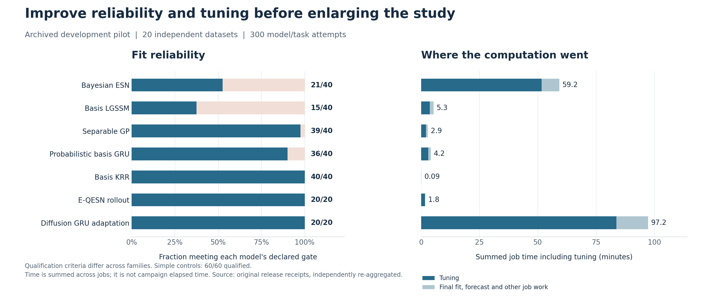

# Post-release audit: reliability, tuning, data, and efficient comparison

**Date:** 2026-11-03. **Audited repository head:** f279c7a47ebe76bc282e0592fa266e96b163acf9.
The implementation at this head is release v0.2.1, ebd2d1a031796cadae5dbb32a992e10b3f7cf653.
The distributed scientific experiments retain their original v0.2.0 identity,
8ee53dfe9f2727d4bf25e26f38d4690007140fd9.

## Decisions

1. **Improve fitting reliability and the actual tuning procedure before enlarging the main study.** The pilot is an honest development comparison under restricted budgets, not evidence that every family has reached its best predictive performance.
2. **Test more history with paired learning curves.** More data may help; the richer demonstration cannot identify that effect because data, geometry, horizon, and architecture changed together.
3. **Choose capacity using temporal and spatial validation, with explicit compute costs.** More reservoir units, a denser plotting grid, more posterior paths, and more independent datasets address different problems.
4. **Keep diagnostic thresholds and independent confirmation data.** Correct the computation and the design rather than redefining success after observing failures.

This audit recomputes archived receipts, inspects the code, and executes bounded diagnostic probes. It does not claim that the proposed sampler, revised searches, or larger-data comparisons have already been implemented or validated. The LGSSM probe is the only optimizer refit; its outcomes are post-hoc development diagnostics, not updated release benchmark scores.

## 1. Evidence and limits of the present conclusions

The pilot comprises four mechanisms, five independent datasets per mechanism, and 300 model/task attempts. Track A predicts future observations at observed sites; track B predicts future observations at never-observed sites. A and B jobs from one dataset are not independent replications.

| Model | Qualified / attempted | Qualification rate | Recorded main reason for failure |
|---|---:|---:|---|
| Bayesian ESN | 21 / 40 | 52.5% | MCMC diagnostics |
| Basis LGSSM | 15 / 40 | 37.5% | EM iteration cap |
| Separable GP | 39 / 40 | 97.5% | Covariance optimizer cap |
| Probabilistic basis GRU | 36 / 40 | 90.0% | Covariance optimizer cap |
| Basis KRR | 40 / 40 | 100% | None recorded |
| E-QESN rollout | 20 / 20 | 100% | None recorded |
| Diffusion GRU adaptation | 20 / 20 | 100% | None recorded |
| Persistence, seasonal naive, spatial persistence | 60 / 60 | 100% | None recorded |

The gates differ across model families. An ESN gate includes four-chain MCMC diagnostics; finite E-QESN or diffusion-GRU fitting does not imply an equivalent convergence or calibration guarantee. Overall, 251 attempts qualified and 49 used declared point fallbacks. There were no recorded execution/scoring failures or broken-process-pool failures.

The smallest operational pilot RMSE in each scenario/track belonged to a comparator, not the Bayesian ESN. Operational scores include the declared fallback; therefore this does not establish that the underlying ESN family is inferior. All ten G3 ESN attempts failed qualification, so their operational errors describe fallback performance. Native probability comparisons condition on both methods qualifying and can favor an easier subset of datasets.

The higher-resolution G4 demonstration is useful evidence that the ESN can forecast well in one setting. It changes initial history from 400 to 2,000 rows, observed sites from 25 to 100, horizon from 40 to 100, and spatial basis from 12 to 28 columns. Relative to the small default pilot candidate with 65 temporal features and 780 readout coefficients, the demonstration uses 197 features and 5,516 coefficients; selected pilot widths/features vary across fits. It also changes GRU rank and uses one proposed setting per model. These changes do not identify a causal benefit of history length or architecture separately.

The current confirmation gate correctly remains blocked: 10 of 64 required primary comparisons lack three common qualified pilot replications. Three is only the factory's minimum for a pilot variance estimate, not a recommended final replication count.

Sources: [archived validation](../../benchmark_validation.md), [raw audit extraction](evidence/results_evidence.json), [original blocked gate](../../evidence/v02/confirmation_gate.json).

## 2. Reliability: specific changes supported by the evidence

### 2.1 ESN: improve the parameterization before repeatedly adding draws

All 40 final pilot ESN fits failed the first 1,000-draw-per-chain gate, continued to 2,000, and only 21 then qualified. Both detailed-demo ESN fits also needed continuation. The dominant failed quantities are ridge log precision, log spatial variance ratio, recovered log observation variance, and log range. The recovered readout functionals passed in all 40 pilot fits; this does not justify accepting failed covariance or scale diagnostics.

G3 acceptance rates were ordinary: approximately 0.193–0.346 across its 40 chains, median 0.274, with no invalid proposals. Yet log spatial amplitude had R-hat up to 1.35 and bulk ESS as low as about 9.5. Acceptance rate alone is an inadequate diagnostic.

The saved scalar-ridge chains reveal a concrete parameter tradeoff. Let

$$
R_q=I+qK,\qquad
b\mid \sigma^2,\lambda\sim N(0,\sigma^2\lambda^{-1}I).
$$

Here K is the unit-diagonal Matérn correlation matrix of the audited iid model. Write

$$
v=\sigma^2(1+q),\qquad
\widetilde R_q=\frac{I+qK}{1+q},\qquad
\kappa=\lambda(1+q).
$$

Then the residual covariance is \(v\widetilde R_q\) and the readout prior covariance is \(v\kappa^{-1}I\). This separates total residual scale from effective shrinkage. A useful coordinate change for the existing collapsed target is

$$
\eta=\log\lambda+\log(1+\exp \xi),\qquad
\xi=\log q,\qquad \zeta=\log\ell.
$$

Its inverse is \(\log\lambda=\eta-\log(1+\exp\xi)\). The Jacobian determinant of the map between the original and new **log coordinates** is one. Therefore, if the current target density is already with respect to \(d\log\lambda\,d\log q\,d\log\ell\), the exact transformed target is

$$
\log\widetilde\pi(\eta,\xi,\zeta\mid Y)
=\log\pi\{\eta-\log(1+\exp\xi),\xi,\zeta\mid Y\}.
$$

Evaluate the existing priors and likelihood at these inverse-transformed values. Do not assign independent replacement priors to the new coordinates. If one instead explicitly samples \(v\), its induced prior and the appropriate Jacobian must also be included.

In replication-zero A chains, the absolute within-chain correlation between log precision and log amplitude was roughly 0.90–0.98 across G1, G3, and G4. The proposed \((\eta,\xi)\) coordinates reduced it to below 0.16 in all 12 inspected chains. This is descriptive geometry evidence; G3 chains remain unqualified, and decorrelation of stored samples does not prove faster mixing.

**Recommended first sampler experiment:** compare the current sampler with a transformed/preconditioned or ridge-aligned MH update targeting exactly the same posterior. Use fixed development datasets, independent prespecified chain seeds, unchanged four-chain R-hat < 1.01 and bulk/tail ESS >= 400 gates, and compare minimum ESS per second plus predictive-functional Monte Carlo error. Try a longer adaptation window before large retained-draw increases. Start with a bounded 1,000-warmup/2,000-retained design and one continuation to 4,000 only when diagnostics are improving. These counts are proposed pilot budgets, not proven optimal defaults.

Compare diagnostics on the same original scientific quantities and fixed functionals in both samplers: log precision, log variance ratio, log range, recovered observation variance, and the readout/predictive functionals. Higher ESS for a different transformed coordinate by itself is not evidence of improved exploration of the original target quantities.

Keep the original likelihood/prior unchanged in this experiment. Separate computational reparameterization from later scientific changes such as grouped ridge or RHS. Check transformed-target equality, posterior agreement on a small reference problem, and exact checkpoint continuation before integrating the new sampler.

Evidence: [chain geometry](evidence/esn_parameter_geometry.json), [receipt extraction](evidence/results_evidence.json). Diagnostic principles: [Vehtari et al.](https://avehtari.github.io/rhat_ess/rhat_ess.html), [Bayesian Workflow](https://arxiv.org/abs/2011.01808).

### 2.2 LGSSM and covariance optimizers: use bounded, meaningful continuation

All 25 failed LGSSM fits stopped at 50 iterations while the finite likelihood was still improving; none recorded a decreasing-step rejection. This is stronger evidence for increasing the cap than a generic desire for more optimization.

The audit selected the first failed job in each scenario/track, capped at six, and changed only maximum iterations from 50 to 200. The original tolerance remained \(10^{-5}\). All six reproduced the original first 50 likelihood values bit for bit. Five jobs then passed, at iterations 56, 81, 109, 109, and 56; one G4/A job still failed at 200. These six jobs represent four independent datasets and five distinct data/configuration fits; G3/A and G3/B repeat one deterministic final fit.

The probe used 28.5 CPU seconds, 27.8 wall seconds, and about 101 MiB peak process RSS, with a 1 GiB address-space cap. It did not calculate new test forecasts or replace the published scores.

**Recommendation:** increase the EM allowance selectively for monotonically improving fits and preserve the convergence criterion. Investigate persistent slow cases with parameter/objective traces rather than declaring any finite iteration a success. For the four basis-GRU covariance failures at 40 iterations and the one GP failure at 60, inspect projected gradients, boundaries, and exit messages; try bounded continuation and, where appropriate, a few independent starting points. No rescue rate has yet been established for those two optimizers.

Evidence: [LGSSM probe](evidence/lgssm_iteration_probe.json).

## 3. Tuning: make the search substantive and comparable

### 3.1 Correct the search mechanics

The pilot allows three proposed settings. Duplicates are removed without replenishing the budget. A configuration-only enumeration over 20 fixed search seeds found only 2–3 unique ESN/LGSSM candidates in some pilot searches. The main profile caps proposals at 12; values above 12 are currently rejected.

Most consequentially, **basis GRU receives one identical configuration on every trial**. Its effective architecture search is exactly one candidate even when trials is 12. The main draft also omits this comparator despite including it in the pilot and demonstration.

There is a separate configuration hazard: shallow dictionary updates replace the entire nested ESN feature specification. Setting only a new leak pattern can discard the sampled width/depth/input-scale choices and restore adapter defaults. The existing detailed profile deliberately supplies a complete feature mapping, so this observation does not invalidate that run.

Implement:

1. Explicit candidate construction with unique configurations or honest exhaustion of a finite search space.
2. Validated recursive overrides, or fully resolved configurations, with provenance for every effective setting.
3. A real basis-GRU search and an explicit confirmatory model roster.
4. Effective-candidate counts and changed dimensions in each selection receipt.
5. Diagnostic-qualified finalist evaluation. Cheap screening may remain approximate, but an unqualified screening run should not become the trusted winner merely through an attractive noisy score.

Sources: [protocol](../../../src/bayes_stesn/benchmark/protocol.py), [runner](../../../src/bayes_stesn/benchmark/runner.py), [enumeration](evidence/candidate_enumeration.json).

### 3.2 Model-specific tuning priorities

| Family | Current important limitation | First bounded improvement |
|---|---|---|
| Bayesian ESN | Searches width/depth/input scale/quadratics but fixes small spatial basis, PCA modes, short lags, leak patterns, and innovation family | Repair sampler; then compare modest spatial rank/width, modes 4/8/12, lag sets (1,2), (1,2,4), (1,4,8), and leak patterns. Pair these with shrinkage rather than increasing all dimensions. |
| Basis GRU | One candidate; rank 8 and context 8 fixed in pilot | Eight distinct candidates across rank 8/16/24, context 8/16/32, modest width, learning rate, and decay, bounded by sensor count. |
| Diffusion GRU | Seven-dimensional search with only three proposals; high cost | A small space-filling search; tune context and rollout horizon before adding layers. Charge all training and selection costs. |
| LGSSM | Most fits hit 50-iteration EM cap | Rescue computation first; then validate rank and basis width. Add seasonal/oscillatory structure only as an explicit model extension. |
| Separable GP | Limited kernel family; fitted lengths and amplitudes already optimized | Converged multistart fits, kernel/mean adequacy checks; consider an explicitly named periodic/damped-oscillator variant if validation supports it. |
| Basis KRR | Temporal kernel tuning exists, spatial rank/width remain fixed | Tune spatial dictionary and regularization cheaply; retain this strong inexpensive control. |
| E-QESN | Finite reservoir ensemble has no observation innovations | Keep its original interpretation visible; evaluate an explicitly named residual-innovation or interval-calibrated variant if probability accuracy is a target. |
| Simple controls | Fixed spatial persistence and a few explicit seasonal periods | Small training-only period/length/penalty searches; retain fixed fallback rules independently. |

The ridge precision is already inferred hierarchically; it is not fixed at 0.1. A grouped-ridge ablation is a sensible next prior because it relaxes one common shrinkage level while retaining favorable algebra. Group/column RHS can follow if improved validation or a principled sparsity assumption supports it. Entrywise RHS, a nonstationary covariance, and latent residual dynamics should not all be introduced at once.

RHS is not a universal upgrade. Its global scale should reflect a declared sparsity belief or a training-reference prior-predictive calibration. Blind substitution of \(Tn\) into an independent-design default is not justified for correlated spatial predictors and redundant reservoir features. Changing priors changes the statistical model and requires a fresh controlled comparison. [Piironen and Vehtari](https://arxiv.org/abs/1707.01694) provide the relevant sparsity/regularization framework.

### 3.3 Match selection to the forecasting task

Basis GRU currently trains one-step coefficient MSE and selects epochs using only 16 free-running steps. Diffusion GRU trains a four-step objective and selects epochs over at most 64 steps. The outer task is 40 or 100 steps. Align stopping with the actual target horizon or a prespecified weighted set of leads. A multistep training curriculum is a later training-method ablation, with its own cost record.

Maintain three forward validation origins and a single sealed final origin. Conditioning states on observed history between origins is legitimate; using future values within an evaluated rollout is not. The audited code respects this distinction.

Track B currently hides the rightmost fifth of observed sites. This emphasizes boundary extrapolation, whereas final U contains locations throughout the domain. Use a small prespecified set of interior-gap and edge blocks; report interpolation and extrapolation separately. Refit response-dependent transforms within each spatial training subset.

Probabilistic families currently select CRPS, while point families select RMSE. This is defensible for their declared objectives, but a CRPS-selected probabilistic model is not necessarily that family's best RMSE configuration. State the primary claim. If point prediction is central, provide an RMSE-selected comparison for all families; if distribution prediction is central, compare CRPS-selected native distributions and keep point controls in the point table.

Start with 8–12 informative candidates and two finalists evaluated with a prespecified set of fresh seeds. A larger search is warranted when its validation improvement exceeds its variability and its resource budget permits it. Expanding beyond 12 requires a versioned protocol change. Random/space-filling search is an adequate first method; a sophisticated optimizer is not required to correct a missing search. See [Bergstra and Bengio](https://jmlr.org/papers/v13/bergstra12a.html) and [Cawley and Talbot](https://www.jmlr.org/papers/v11/cawley10a.html).

## 4. Training data: what to increase and how to identify the benefit

### 4.1 Four distinct meanings of more data

| Increase | What it can improve | What it does not establish |
|---|---|---|
| Historical time rows | Dynamics/readout estimation and coverage of temporal regimes | Independent information grows proportionally to T under arbitrary dependence |
| Observed sensors | Spatial reconstruction and covariance estimation | A finer evaluation grid alone supplies training information |
| Independent DGP datasets | Precision and generality of the comparison | Better training of each separately fitted model |
| Posterior draws / forecast paths | Monte Carlo precision | More observed information or reduced model bias |

For the iid-time Gaussian readout, coefficient information is \(G\otimes B\), with \(G=Z^\top Z\) and \(B=\Phi^\top R^{-1}\Phi\). Its eigenvalues and conditioning, not merely \(Tn\), determine what is estimable. The current conditional likelihood does not assert that the endogenous reservoir feature sequence is an independent random design. Residual temporal dependence is a model-adequacy issue if the iid innovation specification does not capture it.

Longer history is the economical first experiment at fixed sites and feature dimensions: the scalar-ridge implementation caches sufficient statistics. More observed sites has a stronger dense spatial cost. More historical data may also hurt after an unmodeled regime change, so G6 should have a separately declared adaptation/window experiment rather than being pooled with stationary learning curves.

The ESN learns PCA, response scaling, feature scaling, and interlayer calibration only on its conditioning prefix. That prefix is 80 rows in the pilot and capped at 200 in the larger profiles. At 4,000 rows, the current automatic rule still uses 200 for those transformations. More history therefore does not automatically improve the encoder. Any change to conditioning length must leave every transform fitted strictly before scored validation observations.

### 4.2 A paired history experiment

First establish whether a model has substantial avoidable error. A bounded audit of all five original G1 datasets used the implemented Gaussian oracle with true parameters and exactly the same noisy observed-site history. No latent or hidden state arrays were loaded.

| Track | Known-parameter reference RMSE | Fitted GP RMSE | Relative gap |
|---|---:|---:|---:|
| A | 0.7849 | 0.7875 | 0.33% |
| B | 0.9246 | 0.9298 | 0.57% |

This indicates little remaining GP point-error headroom in the easy case under this five-dataset comparison. More history cannot remove future process and measurement innovations. The oracle conditional mean minimizes expected squared error under the known DGP; its realized RMSE is not a lower bound that must hold on every finite realization. Oracle CRPS is analytic, whereas comparator CRPS uses empirical predictive paths, so their finite-simulation conventions differ.

Qualified G1 ESN fits remain appreciably worse than the oracle on matched subsets (A: 1.0522 versus 0.8068 on three datasets; B: 1.1020 versus 0.8895 on two). This motivates checking linear/state dynamics, spatial representation and regularization in addition to sampling. If training residuals retain temporal dependence, a controlled comparison using the already implemented full-residual AR or latent AR extension is more motivated than another unconditional width increase. Such an extension changes the model and may lose the fastest iid sparse route.

Evidence: [G1 oracle audit](evidence/g1_oracle_audit.json); runtime about 0.12 seconds and 83 MiB process peak in this diagnostic.

Use initial history lengths \(L\in\{500,1000,2000,4000\}\), with one shared initial validation endpoint \(E=4000\), three 100-step validation blocks, and final origin \(E+300=4300\). Then:

$$
\text{initial training}=[E-L,E),\quad
\text{validation origins}=\{4000,4100,4200\},\quad
\text{final refit}=[E-L,4300),\quad
\text{test}=[4300,4400).
$$

All lengths use the same generated trajectory, sensors, target locations, and final observations within a replication. Final supplied history is \(L+300\), and ESN likelihood rows additionally exclude its declared conditioning prefix. Existing history-curve machinery already preserves these endpoints.

Use two clearly labeled comparisons:

- **Fixed specification:** hold spatial/temporal architecture, conditioning policy, prior, and inference targets fixed; measure the effect of more fitting history.
- **Retuned pipeline:** allow each family to select within its declared search as history increases; measure practical achievable performance under the allocated compute.

Begin with G1, G3, and G4 on existing development seeds and a small common model panel: reliable ESN, GP, basis GRU, and inexpensive KRR/persistence controls where supported. Five paired datasets per mechanism are a development screen, not confirmation. Resolve all four length profiles upfront at the common endpoint E=4000, then execute only the central 1,000 and 2,000 profiles first; execute the other resolved profiles if the shape of the curve remains unresolved. The existing helper sets E to the maximum requested length: calling it initially with only 1,000 and 2,000 would use E=2000 and would not preserve the proposed test window when later adding 4,000. An explicit common-endpoint argument is an alternative implementation improvement. Full retuning multiplies cost, so freeze suitable development candidates for the first fixed-specification curve.

A separate sensor curve can use 25, 50, and 100 nested O sites at fixed T. Reserve the largest O set before defining C/U, keep U unchanged, and score A on the common smallest O subset. Existing sensor-curve machinery supports that logic. Avoid a full history-by-sensors-by-width-by-prior factorial unless a specific interaction motivates it.

### 4.3 Capacity must be assessed with regularization

The iid ESN conditional mean \(\mu_t(s)=\phi(s)^\top C z_t\) lives in the chosen spatial span. Extra reservoir units cannot insert missing spatial basis functions. However, an unregularized larger basis can amplify noise or extrapolate badly.

The audit reconstructs four replication-zero training panels using contemporaneous least squares, only the first 400 rows and 25 O sites. A 28-column ESN dictionary interpolates those 25 responses exactly, including noise. The same existing pseudoheld boundary split has only 20 fitting sites. Increasing Gaussian-RBF rank from 8 to 16 worsened held-site reconstruction in all four examples, despite better fitted reconstruction. For G4, its normalized held error rose from about 1.53 to 3.41.

These are geometric diagnostics, not trained forecast comparisons or oracle selection criteria. They establish why rank, width, geometry, and shrinkage should be considered together. Use training/reference reconstruction checks to locate limitations, then genuine temporal/spatial validation to choose a model.

Evidence: [decoder probe](evidence/decoder_probe.json).

## 5. Fair and informative comparisons

Preserve the existing strengths: shared DGP datasets, observed/calibration/test spatial roles, chronological validation, frozen-parameter rollouts, independent final seeds, explicit fallbacks, saved receipts, and replication-level uncertainty.

Add the following:

1. **Two performance estimands.** Report all-attempt operational accuracy and qualification probability. Also report native distribution performance on explicitly counted common qualified datasets. A conditional CRPS comparison is not the all-attempt performance of an operational system.
2. **Equivalent information, sensible family-specific tuning.** Equal parameter counts or equal trial counts are not universal definitions of fairness. Report accuracy under bounded tuning and an accuracy-versus-total-compute frontier. If an equal-compute comparison is desired, declare a second budget-controlled analysis.
3. **Separate sources of variability.** DGP datasets, fitting/reservoir seeds, posterior Monte Carlo error, and forecast Monte Carlo error are distinct. Repeated seeds improve stability assessment but do not increase the number of independent simulated datasets.
4. **Paired precision.** For dataset-level normalized losses \(L_{rm}\), use \(d_r=L_{rm}-L_{rb}\), \(\bar d=R^{-1}\sum_r d_r\), and \(\mathrm{MCSE}(\bar d)=s_d/\sqrt R\). Resample whole independent datasets for intervals. Do not count sites or forecast leads as independent replications.
5. **Planning after changes.** Re-estimate paired variability from the revised development workflow. The old pilot uses a different data size and horizon from the main draft. A variance estimate from it does not guarantee the new design's precision. The existing formula \(R\approx s_d^2/\epsilon^2\), bounded at 20–60, is an approximate MCSE plan, not a hypothesis-test power calculation. Prefer a small primary comparison set and show any unmet precision at the cap.
6. **Prediction targets and information-matched references.** Noisy-observation RMSE is primary; latent truth can be an evaluator-only secondary diagnostic. G1's implemented known-parameter Gaussian oracle conditions on the same noisy O history and gives a useful reference. Its known parameters are privileged information and must be labeled.
7. **Joint and marginal behavior.** Keep CRPS, RMSE/MAE, coverage with width and interval score, spatial/temporal variograms, and fixed path functionals. Avoid judging uncertainty from coverage alone or marginal CRPS alone.
8. **Ensemble simulation precision.** Current CRPS scores the empirical forecast distribution exactly. For iid Monte Carlo draws from an underlying distribution, this V-statistic has an \(O(M^{-1})\) finite-sample offset. Check 128/256/512-path stability on fixed finalists and use appropriate Monte Carlo-error accounting. An enumerated finite E-QESN distribution is the actual declared forecast, so applying an iid-sampling correction to it changes the estimand.
9. **Prespecified scenario diversity.** Retain the easy Gaussian reference, transport, excitable dynamics, and fronts. Add G5 noise stress and G6 velocity shift as separate stress analyses after basic reliability, with their information assumptions explicit. Do not choose DGP parameters or seeds because they make ESN win.
10. **Accurate method labels.** Diffusion GRU and recursive E-QESN are declared adaptations; basis GRU is a custom probabilistic control. They are not verified reproductions of every published named architecture.

An example of why multiple scores matter: E-QESN has strong G3/A and G4/A point accuracy, but its nominal 90% marginal coverage averages only about 36.46% and 56.40%, respectively. In G4/A it has better CRPS than ESN but worse 90% interval score. Increasing its number of reservoir members alone does not add the missing observation-innovation model. A new residual-innovation variant should be trained/calibrated without final labels and reported separately from the original ensemble.

Simulation reporting and Monte Carlo precision: [Morris, White, and Crowther](https://pmc.ncbi.nlm.nih.gov/articles/PMC6492164/). Joint scoring: [Scheuerer and Hamill](https://repository.library.noaa.gov/view/noaa/22327/). A modern shared forecasting pipeline reference: [TFB](https://arxiv.org/abs/2403.20150).

## 6. Compute and memory: protect the budget while spending it usefully

### 6.1 Observed environment and existing safeguards

The audited executor has an enforced 8 GiB memory limit, 8 CPU equivalents, no swap, and roughly 56.7 GiB free disk at inspection. These describe this executor, not the user's laptop, a GitHub-hosted runner, or Hummingbird. Recheck resources on each execution host.

The runner already limits BLAS/Torch threads per process, uses named random streams, caps workers at four, and performs a memory planning check. Start larger fits with two workers, one numerical thread each, and an aggregate job budget around 5 GiB in this 8 GiB environment. Admit more jobs only after isolated representative measurements and current cgroup headroom justify them. Keep approximately 2 GiB safety headroom plus room for other processes; these are operational choices, not guaranteed sufficient bounds for every model.

The historical cgroup peak previously reached its limit, but no OOM kills were recorded. That history cannot be attributed to this project.

Published per-job RSS values are process-lifetime high-water marks in reused workers. They cannot rank model memory. Profile each representative fit in an isolated subprocess and monitor aggregate cgroup/process-group usage. The existing memory estimate should include model ranks, feature counts, state dimensions, and duplicate forecast arrays; an explicit user budget must never override a smaller enforced ceiling.

### 6.2 The largest cost is tuning

| Family | Summed job time including tuning | Tuning time | Tuning fraction |
|---|---:|---:|---:|
| Diffusion GRU adaptation | 5,834.7 s | 5,020.0 s | 86.0% |
| Bayesian ESN | 3,554.4 s | 3,102.2 s | 87.3% |
| LGSSM | 320.1 s | 220.1 s | 68.7% |
| Basis GRU | 249.5 s | 186.7 s | 74.9% |
| Separable GP | 172.5 s | 123.6 s | 71.7% |
| E-QESN | 108.7 s | 99.7 s | 91.8% |
| KRR | 5.4 s | 4.1 s | 76.3% |

ESN and diffusion GRU account for approximately 91.6% of summed job time. These are summed wall durations from the archived run, not campaign elapsed time or a controlled hardware speed comparison. Improve meaningful candidate allocation, solver reuse, and finalist screening there first. Recomputing the 300-receipt aggregate took only about 0.026 seconds in the audit; replacing summary writes is not a priority without new profiling.

Preserve exact cached sufficient statistics and the successful endpoint-checkpoint optimization. The documented 3.52-fold checkpoint speedup is one measured workload, not a universal guarantee.

### 6.3 Batching and scalability

One float64 observation tensor of M paths, H leads and n targets costs \(8MHn\) bytes. At 256 by 100 by 505, that is 98.6 MiB. Four components cost approximately 394.5 MiB before work arrays. The benchmark requests only observation draws, but its adapter materializes all paths, the Forecast constructor defensively copies them, and scoring needs additional buffers.

The core offers globally indexed path batching, but the full benchmark/scoring route is not yet streaming. First eliminate redundant internal copies with explicit array ownership while preserving safe public constructors. Use memory-mapped output or batch consumers when larger dimensions justify them. Simulate coherent whole-field paths; marginal scoring can then process site/lead chunks. Independently simulating spatial tiles would change the joint forecast law.

For the collapsed separable ridge route, preserve spatial/temporal eigensystem algebra. General readout coefficient dimension \(k=pd\) can make dense \(k\times k\) storage and cubic factorization prohibitive. More flexible priors and covariance/dynamics combinations do not all inherit the scalar-ridge sparse complexity.

The 4,096-site sparse profile used only 35 likelihood rows, one chain, two warmup iterations, three retained draws, four paths and eight leads. It establishes that execution case, not large-data scientific convergence. Maintain the explicit supported sparse combination: iid Gaussian innovations, scalar ridge, collapsed latent Vecchia; account for sparse fill and dense readout factors.

### 6.4 Recovery fixes before a large campaign

Three source-confirmed issues merit focused implementation:

- Worker count and memory budget are hashed into run identity, preventing a smaller worker count on resume. Separate immutable scientific identity from execution-attempt metadata while preserving source, data, protocol, and numerical-runtime checks.
- Broken worker pools can produce persisted fallback receipts for queued jobs that never fitted, and resume skips those receipts. Distinguish retryable infrastructure interruption from a model that exhausted its declared fitting budget. Preserve bounded retry accounting and report unresolved interruptions.
- A fresh benchmark ESN call does not automatically resume a surviving checkpoint; only its in-call diagnostic extension uses resume. Record phase and target draw count and explicitly recover a compatible initial/continuation checkpoint.

No such infrastructure failure occurred in the published pilot. These are scaling/recovery risks, not evidence its scores were corrupted.

Evidence: [resource snapshot and timing](evidence/compute_evidence.json).

## 7. GitHub: use the functioning path and keep authorization specific

The public repository and original history now exist. The one-time bootstrap is finished. Ordinary source/document updates can use the already functioning authenticated GitHub connector. The earlier CLI push obstacle was unavailable local HTTPS authentication; repeating that failed path or the history import adds no value.

For subsequent implementation:

1. Read the exact remote head and branch from it.
2. Make a coherent change, run the relevant checks, and commit through the working authenticated path with expected-parent checks.
3. Run CI on the actual proposed commit; do not infer remote success from a local bundle or merely committed workflow.
4. Preserve existing release tags; create a new version for changed science or implementation, with separate numerical and software evidence.
5. Keep ordinary CI at repository-content read permission. A publishing job can request only its needed repository-local content write permission. Workflow-file changes may need separate Workflows permission.
6. Attach checksummed reports/results as release assets rather than placing large binary experiment histories into normal source commits.

The user's authorization covers routine work on this project; it does not create missing provider credentials or technically expand connector scopes. Broad account administration, disabling checks, and global write-all permissions are unnecessary. A workflow-created push using GITHUB_TOKEN also does not generally trigger another push workflow; explicit dispatch/observed CI remains important for automation.

Current official references: [repository contents permissions](https://docs.github.com/en/rest/repos/contents), [GITHUB_TOKEN](https://docs.github.com/en/actions/concepts/security/github_token), [release endpoints](https://docs.github.com/en/rest/releases/releases).

## 8. Ordered implementation and experiment plan

| Stage | Concrete work | Exit evidence | Resource policy |
|---|---|---|---|
| 1. Computation and orchestration | Sampler coordinate prototype; optimizer continuation; nested configuration resolution; retry/resume identity fixes; basis-GRU candidates | Exact target/reference checks, unchanged diagnostic thresholds, meaningful unique candidates, recovery tests | Small matrices; selected archived development cases; two workers maximum initially |
| 2. Focused reliable fits | G1/G3/G4 sentinel datasets; compare current and revised sampler by ESS/sec; optimizer caps/restarts | Diagnosed failure mechanisms; stable finite fits; no systematic near-universal failure in a cell | Bounded wall time, memory and continuation; retain failures |
| 3. Predictive development | 8–12 substantive candidates; qualified finalists; aligned horizon; two or three spatial validation blocks | Paired validation scores, seed variability, cost curves, specified model roster | Candidate caps plus measured time budgets; no full Cartesian search |
| 4. Data/capacity ablations | Fixed-specification history 1,000 vs 2,000 first; extend 500/4,000 if needed; separate sensor curve; grouped-ridge option | Comparable test windows and sites, effect sizes with dataset-level uncertainty | Five development replications per selected mechanism; staged expansion |
| 5. Freeze confirmation | Revised pilot at intended dimensions; primary estimands/models; paired precision calculation; G3 numerical policy | Every planned comparison supported; approximate MCSE target and cap consequences explicit | Plan 20–60 fresh independent datasets only after the gate |
| 6. Confirm and report | Execute sealed design; retain all attempts; compare calibration and joint scores; regenerate saved-result media | Exact manifests, qualification counts, paired intervals, cost/memory measurements, immutable release evidence | Bounded scheduling/checkpoints; render from saved results |

Suggested readiness target for development is high and reasonably stable qualification across every intended scenario, with failure intervals/counts reported. A target such as at least 90% across a larger development set is an engineering aim, not a substitute for MCMC diagnostics and not a claim that five replications precisely estimate a success rate. Never drop a difficult scenario solely to obtain a favorable ESN ranking.

**Immediate recommendation:** implement stages 1–2 first. Then use the evidence to decide how much tuning and data are worthwhile. This ordering attacks demonstrated limitations and preserves the ability to interpret any later improvement.

## Source map and reproducibility

The audited source is pinned at [f279c7a](https://github.com/AntonioAPDL/bayes-stesn/tree/f279c7a47ebe76bc282e0592fa266e96b163acf9).

| Question | Source |
|---|---|
| Candidate search, caps, nested overrides, roster | [protocol.py](https://github.com/AntonioAPDL/bayes-stesn/blob/f279c7a47ebe76bc282e0592fa266e96b163acf9/src/bayes_stesn/benchmark/protocol.py) |
| Selection, spatial split, workers, identity and failures | [runner.py](https://github.com/AntonioAPDL/bayes-stesn/blob/f279c7a47ebe76bc282e0592fa266e96b163acf9/src/bayes_stesn/benchmark/runner.py) |
| ESN fit/continuation and complete-path materialization | [esn.py](https://github.com/AntonioAPDL/bayes-stesn/blob/f279c7a47ebe76bc282e0592fa266e96b163acf9/src/bayes_stesn/benchmark/esn.py) |
| Learning curves and confirmation gate | [studies.py](https://github.com/AntonioAPDL/bayes-stesn/blob/f279c7a47ebe76bc282e0592fa266e96b163acf9/src/bayes_stesn/benchmark/studies.py) |
| Score estimands and aggregation | [metrics.py](https://github.com/AntonioAPDL/bayes-stesn/blob/f279c7a47ebe76bc282e0592fa266e96b163acf9/src/bayes_stesn/benchmark/metrics.py) |
| Mathematical model and available extensions | [models.md](../../models.md) |

The scripts in [scripts](scripts/) read the original public scientific archives directly and materialize only selected small members when needed. Download both scientific ZIP files from [v0.2.1 release assets](https://github.com/AntonioAPDL/bayes-stesn/releases/tag/v0.2.1) into a data directory. They need NumPy/SciPy and the core package; the overview additionally needs Matplotlib. Use the project's tested environment and PYTHONPATH=src from the repository root when running without an installation.

~~~bash
export OPENBLAS_NUM_THREADS=1 OMP_NUM_THREADS=1 MKL_NUM_THREADS=1
export PYTHONPATH=src
AUDIT=docs/audits/post_release_2026_11_03
python "$AUDIT/scripts/analyze_saved_results.py" --assets /data/bayes-stesn-release --output /data/bayes-stesn-audit
python "$AUDIT/scripts/candidate_enumeration.py" --config-dir configs/benchmark --output /data/bayes-stesn-audit/candidate_enumeration.json
python "$AUDIT/scripts/probe_esn_parameter_geometry.py" --assets /data/bayes-stesn-release --output /data/bayes-stesn-audit
python "$AUDIT/scripts/probe_lgssm_iterations.py" --assets /data/bayes-stesn-release --output /data/bayes-stesn-audit
python "$AUDIT/scripts/decoder_probe.py" --assets /data/bayes-stesn-release --output /data/bayes-stesn-audit/decoder_probe.json
python "$AUDIT/scripts/g1_oracle_audit.py" --source-root . --archive /data/bayes-stesn-release/bayes_stesn_v02_pilot_results.zip --output /data/bayes-stesn-audit/g1_oracle_audit.json
python "$AUDIT/scripts/render_audit_overview.py" --evidence "$AUDIT/evidence" --output /data/bayes-stesn-audit/figures
~~~

The evidence records the original source identity. If these scripts are run after changing model code, the result is a new audit and must be labeled accordingly. Optimizer-probe timing and memory are host-specific; scientific numerical agreement is separately checked. The recorded runtime snapshot is historical and cannot be reproduced as a constant.
